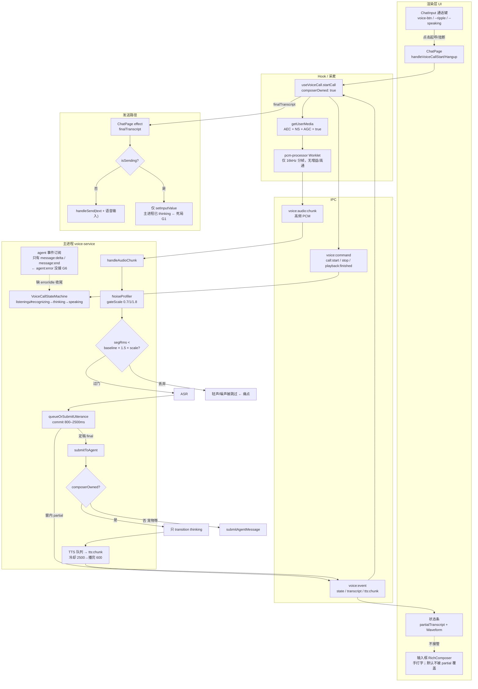
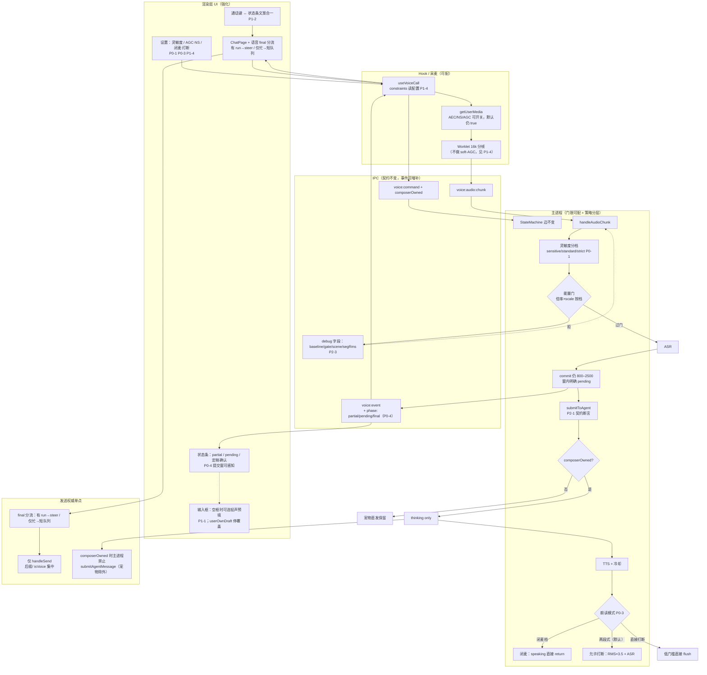
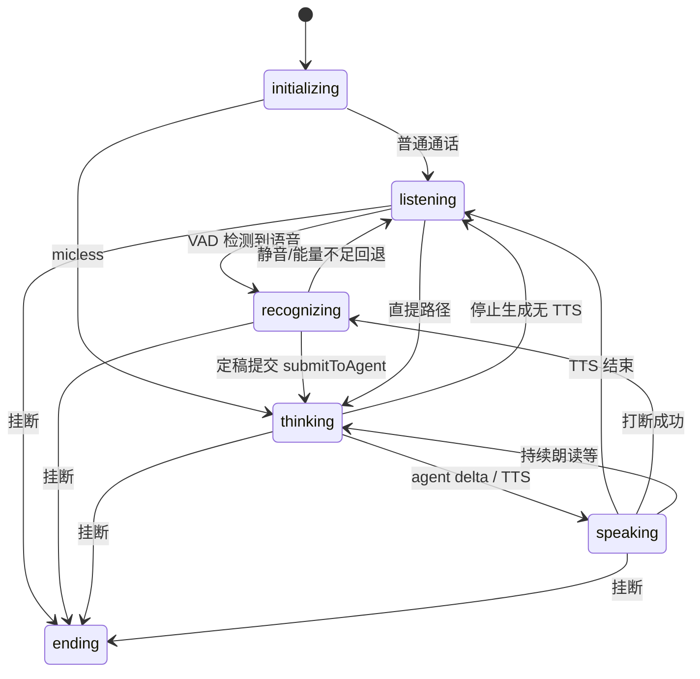
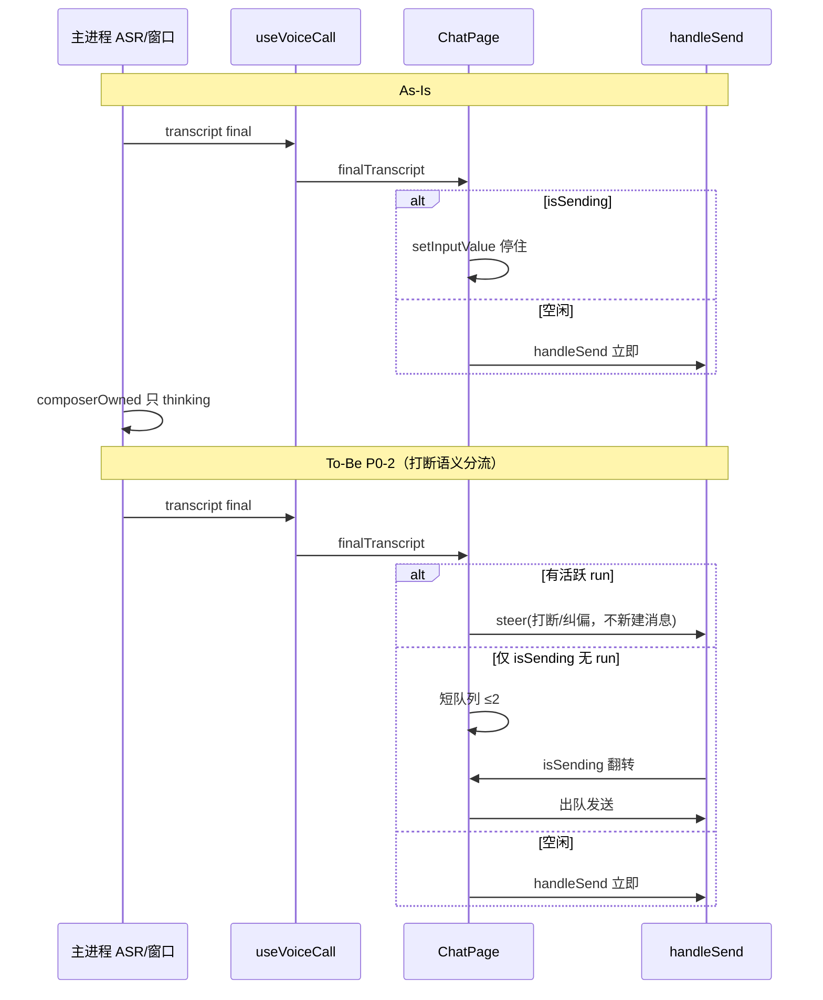
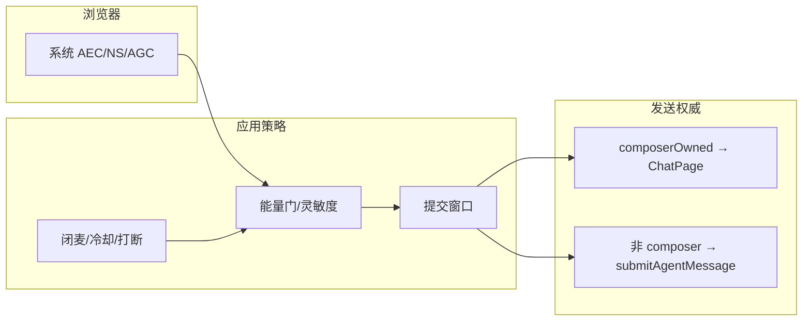
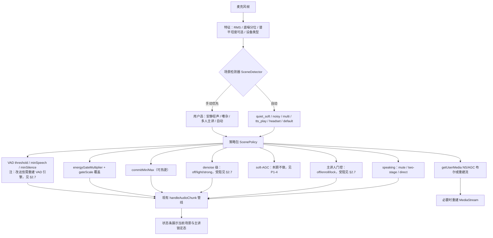
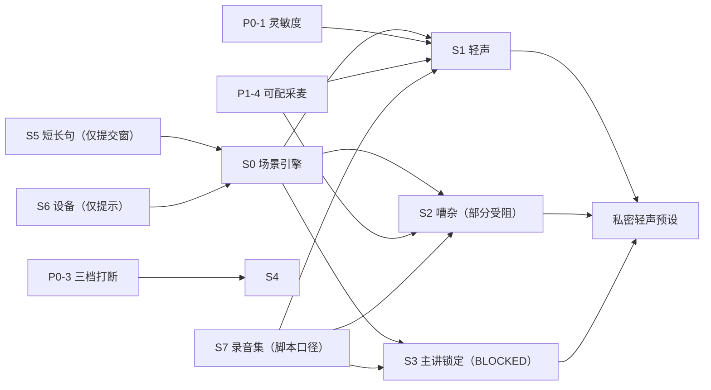

# 语音通话实时优化计划

> **日期**：2026-11-01  
> **状态**：进行中（对照下方进度表实时勾选）  
> **范围**：对话页语音通话（ChatInput 入口 / composerOwned / VAD 能量门 / 系统 AEC·AGC）  
> **约束**：本文件只做计划与进度；业务代码变更在对应任务分支落地后回写本表。  
> **依据**：REA 通话链路探查、回音消除探查、音频前端探查、P0–P2 优化建议；**§2.5 用户场景深度研究**（嘈杂/多人/小声及其他）。  
> **更新**：2026-11-01 增补场景化策略与 S 系列任务。  
> **修订（2026-11-01 晚）**：对照已合入的 `9b215e41` 与现行代码逐条核对，修正 §1 三处与代码不符的锚点（新增 §1.1），补全 **§2.6 业务闭环缺口** 与 **§2.7 开工阻塞**，把 P0-2 从「排队自动重发」改判为「打断语义分流」，新增 **P0-0 回归验收** 与 **P0-4 识别可见性**，并重排 §6 落地顺序。结论：**P0/P1/P2 可开工；S 系列暂不可开工**（阻塞见 §2.7）。

---

## 0. 实时进度总表（每完成一项立即更新）

### 0.A 基线工程项（原 P0–P2）

| ID | 优先级 | 标题 | 状态 | 开始 | 完成 | 偏差记录 |
| --- | --- | --- | --- | --- | --- | --- |
| P0-0 | P0 | 回归验收：真机复跑三条原始 bug | `TODO` | 2026-11-01 | — | 代码已随 `9b215e41` + 本轮 T1–T5 合入，**待真机验收** |
| P0-1 | P0 | 能量门灵敏度分档 / 小声适配 | `DONE` | 2026-11-01 | 2026-11-01 | 抽出 `voice-gate.ts`（门控逻辑搬走，`voice-service.ts` 净减）；新增 `vad.sensitivity` 三档；**只保留一层修正**（档位系数 × 环境系数），不按原计划给三档各配三格 gateScale；单测 `voice-gate` |
| P0-2 | P0 | final / isSending 竞态 → **打断语义分流** | `DONE` | 2026-11-01 | 2026-11-01 | T1（settleTurn + agent:error/idle + tool_use 不回落）+ T2（steer / 短队列 / send 三分支）；单测 `voice-settle-turn`、`voice-final-routing` |
| P0-3 | P0 | 闭麦与打断策略分层 | `DONE` | 2026-11-01 | 2026-11-01 | T4 门槛+回弹；另补 `interruptMode` 三档（`mute`/`two-stage`/`direct`）+ 旧布尔字段迁移 + 设置页/控制坞下拉；`direct` 档门槛降至 1.8x；单测 `voice-config-store` |
| P0-4 | P0 | 识别可见性：pending 态与定稿确认 | `DONE` | 2026-11-01 | 2026-11-01 | T3：`phase` 字段 + `pendingTranscript` + 状态条「记下了，继续补充…」+ 200ms 定稿闪 |
| P1-1 | P1 | partial 轻声预填（输入框空才同步） | `TODO` | — | — | — |
| P1-2 | P1 | 通话键与状态条信息合一 | `TODO` | — | — | — |
| P1-3 | P1 | 提交窗口可感知反馈 | `DONE` | 2026-11-01 | 2026-11-01 | 并入 P0-4 |
| P1-4 | P1 | 采麦前端可配（AGC/NS/能量门） | `DONE` | 2026-11-01 | 2026-11-01 | `capture` 三开关（默认全开）+ `capture-constraints.ts` 统一约束（通话与唤醒共用同一套）；**不做 soft-AGC**（与浏览器 AGC 打架）；改动需重开通话，UI 已明示 |
| P2-1 | P2 | 发送权威单点契约固化 | `TODO` | — | — | — |
| P2-2 | P2 | AEC 预期文档化（设置/帮助文案） | `TODO` | — | — | — |
| P2-3 | P2 | 可观测性调试开关 | `DONE` | 2026-11-01 | 2026-11-01 | T5：`config.debug.gateLog` + 500ms 限流的结构化 gate 日志 |

### 0.B 场景化能力项（S 系列，与场景研究对齐）

| ID | 优先级 | 标题 | 状态 | 开始 | 完成 | 偏差记录 |
| --- | --- | --- | --- | --- | --- | --- |
| S0 | P0 | 场景引擎骨架：检测 → 策略包 → 热切换 | `TODO` | — | — | 依赖 P0-1 的 `voice-gate.ts` 抽取 |
| S1 | P0 | 安静+轻声：松能量门 + 灵敏档 + 关 NS（不做 soft-AGC） | `TODO` | — | — | — |
| S2 | P0 | 嘈杂稳态：高能量门 + 提交窗加长（**降噪分级 `BLOCKED`**，见 §2.7） | `BLOCKED` | — | — | 缺 denoise 模型资产；可先做门控部分 |
| S3 | P1 | 多人旁话：主讲人登记 + 声纹（**`BLOCKED`**，见 §2.7） | `BLOCKED` | — | — | 缺 speaker 模型条目；先做「只标注不丢弃」 |
| S4 | P1 | AI 播报/近扬声器 | `TODO` | — | — | 与 P0-3 合并交付 |
| S5 | P1 | 短/长句：**只做提交窗**（minSpeech 受阻） | `TODO` | — | — | 见 §2.7 |
| S6 | P2 | 设备画像 → 降级为「插拔提示」 | `TODO` | — | — | 见 §2.7 |
| S7 | P2 | 场景手测集（**脚本 + 口径，音频不入库**） | `TODO` | — | — | 见 §2.7 |

### 0.C 语音唤醒（W 系列，2026-11-01 新增需求）

需求原话：「增加一个语音唤醒语音功能。唤醒词：灵栖灵栖。唤醒后进入宠物模式，与宠物 AGENT 对话」。

| ID | 优先级 | 标题 | 状态 | 开始 | 完成 | 偏差记录 |
| --- | --- | --- | --- | --- | --- | --- |
| W1 | P0 | 唤醒词匹配器（同音容错 + 叠词判定） | `DONE` | 2026-11-01 | 2026-11-01 | 不用 sherpa KWS 模型，改用 ASR 文本匹配，见 §7 偏差 |
| W2 | P0 | 主进程唤醒服务（VAD 切段 → ASR → 判定） | `DONE` | 2026-11-01 | 2026-11-01 | 引擎**借用**通话服务的 VAD/ASR，不再加载第二份；单测 `voice-wake-service` |
| W3 | P0 | 渲染层常驻监听（麦克风 + Worklet 推帧） | `DONE` | 2026-11-01 | 2026-11-01 | 独立 `useVoiceWake` + `VoiceWakeListener` 挂在 `App.tsx` |
| W4 | P0 | 唤醒 → 进宠物模式 → 自动开始对话 | `DONE` | 2026-11-01 | 2026-11-01 | 一次性 `pending` 标记 + `voice:wake:consume`，跨窗口不丢事件 |
| W5 | P0 | 设置开关与配置持久化 | `DONE` | 2026-11-01 | 2026-11-01 | 默认**关**（常开麦克风是有代价的） |
| W6 | P1 | 唤醒词可自定义 / 多唤醒词 | `TODO` | — | — | 当前写死「灵栖灵栖」 |
| W7 | P1 | 唤醒灵敏度（误唤醒 vs 漏唤醒）可调 | `TODO` | — | — | 现为「≥0.45s 且两字连续命中」 |

**状态枚举**：`TODO` → `DOING` → `DONE`（或 `BLOCKED` / `DEFERRED`，须在「偏差记录」写原因）。

**勾选规则**：

1. 开工当日把该行改为 `DOING` 并填「开始」。
2. 验收标准全部通过后改为 `DONE` 并填「完成」。
3. 与预设目标偏差（改参数、砍范围、延期）必须写「偏差记录」一行原因，不得静默改目标。

---

## 1. 现状锚点（探查冻结值，改参对照用）

| 项 | 当前生产默认（权威） | 备注 |
| --- | --- | --- |
| AEC / NS / AGC | 浏览器 `getUserMedia`：`echoCancellation/noiseSuppression/autoGainControl = true` | 主进程无自研 AEC、无参考信号；**Web 标准的 NS 只有布尔，没有强度档** |
| `noiseBaseline` 初值 | `0.01` | 前 `NOISE_ESTIMATE_FRAMES=30` 帧估基线（仅静音帧） |
| `energyGateMultiplier` | `1.5` | 有效门 = baseline × multiplier × gateScale |
| `gateScale` | quiet `0.7` / normal `1` / noisy `1.8` | `NoiseProfiler`，`floor()` 25 分位、需 ≥32 帧样本 |
| 打断 RMS 倍率 | `INTERRUPT_RMS_MULTIPLIER=2.5` | speaking 路径；baseline 0.01 时约等于段 RMS 0.025 |
| 打断冷却 | `INTERRUPT_COOLDOWN_MS=600` | |
| TTS 后冷却 | `POST_SPEECH_COOLDOWN_MS=2500`，播完可缩至 `600` | `onPlaybackFinished` |
| VAD | `threshold=0.5`，`minSpeechMs=250`，`minSilenceMs=500` | 以 `DEFAULT_VOICE_ENGINE_CONFIG` 为准（构造函数内联写的是 0.6/300，`startCall` 前会被 `loadVoiceEngineConfig` 覆盖，勿混用） |
| 提交窗口 | `commitMinMs=800`，`commitMaxMs=2500` | 窗内只推 partial |
| 发送 | 对话页 `composerOwned: true`；final → `handleSend(text + 「（语音输入）」)` | **isSending 时只塞输入框，既不自动发、也不清主进程状态**（见 §2.6 G1） |
| partial UI | 状态条，不进输入框 | |
| 启呼默认 | `autoMuteMicWhileSpeaking = false` | `9b215e41` 已改；老配置里显式 `true` 被 `resolveAutoMute` 保留 |

能量门公式：

```text
effectiveGate = energyGateMultiplier * noiseProfiler.gateScale()
跳过 ASR 当：segRms < noiseBaseline * effectiveGate
```

### 1.1 对照代码的锚点修正（2026-11-01 晚复核）

原版 §1 与 §2.5 有几处与**已合入的代码**不符，照原样开发会做重或做错，先钉死：

| 原计划说法 | 代码实际 | 处置 |
| --- | --- | --- |
| P0-3「默认 `autoMuteMicWhileSpeaking=true`」 | 已是 `false`，两段式打断已上线 | **不许改回 true**；P0-3 改为「档位化 + UI 互斥」 |
| P0-2「final 入队 → 空闲后自动发」 | 语音场景里"上一轮还在跑"= 用户开口打断，行业做法是**取消当前回合**而非排队 | **改判**，见 §3 P0-2 |
| 「NS 强度档 light/strong」 | Web 标准只有布尔；Chromium 不提供强度 | 只有"自研 denoise 模型"能分级 → 划入 S2，且**受阻**（§2.7） |
| 「sherpa 有 speaker 能力，S3 可直接做」 | `sherpa-onnx-node@1.13.4` **导出了** `speaker-identification.js` / `non-streaming-speaker-diarization.js`，但 `MODEL_CATALOG` 里**一个声纹/降噪模型都没有**，也没有下载链路 | S3/S2 **暂不可开工** |
| 「渲染侧压音 + 主进程 ASR 确认 = 两段式」 | 渲染侧门槛 RMS `0.02`（固定）**低于**主进程 `baseline×2.5≈0.025` | 存在「一直压音但永不确认」的窗口，见 §2.6 G3 |
| §2.2 图「主进程禁止再 `submitAgentMessage`」 | 宠物模式仍走它；只有 `composerOwned` 时禁止 | 表述收口为「composerOwned 时禁止」，否则与 §2.4 自相矛盾 |

**另需注意**：`voice-service.ts` 已 ~1700 行（项目上限 800）。P0-1/P2-3 继续往里加会失控，落地时必须把 `handleAudioChunk` 的门控段抽成独立文件（见 §3 P0-1 改动落点）。

---

## 2. 代码地图（现状 vs 优化后）

用流程图标清：**模块怎么串、痛点在哪、改完后目标态长什么样**。节点旁标注关键文件；菱形为决策/门禁。

### 2.1 现状代码地图（As-Is）

**技术现状一句话**：对话页通话已「输入框常在 + composerOwned 防双发」；回声靠浏览器 AEC + 闭麦/冷却策略；小声主要靠系统 AGC，主进程只做相对噪声底的能量门（易误杀轻声）；partial 只上状态条；**final 遇 `isSending` 只塞输入框，主进程却已进 thinking —— 状态与消息两头落空**。



**现状痛点对照（图中已标）**

| 位置 | 现象 | 对应优化项 |
| --- | --- | --- |
| 能量门 `GATE` | 轻声 `segRms` 过低被丢 | P0-1、P1-4 |
| `isSending` → `PARK` | 消息没发出、状态机却已进 thinking（G1），连说第二句也不发 | P0-2 |
| `AGT` 未接 `agent:error`/`idle` | 出错后通话僵死（G6） | P0-2 |
| speaking + 策略闭麦/冷却 | 打断难 / 或回采 / 压音不回来（G3） | P0-3 |
| partial 只上 `BAR` | 框内无「边说边出字」 | P1-1 |
| 提交窗静默等待 | 分不清"在识别"还是"在等我说完"（G4/G5） | P0-4 |
| 无参考信号 AEC | 只能靠系统 AEC + 策略 | P2-2（预期对齐） |
| 缺调试字段 | 误杀难复盘 | P2-3 |

### 2.2 预期优化后代码地图（To-Be）

**预期目标一句话**：小声可调灵敏度进门；final 按打断语义分流；闭麦/打断分层可配；UI 键条合一且提交/定稿可感知；发送权威单点可测；调试可观测——**仍不引入自研参考 AEC**。



**改造点 → 预期效果**

| 图中节点 | 改什么 | 预期效果 |
| --- | --- | --- |
| `SENS` / `GATE2` | 三档灵敏度 + 可配倍率 | 轻声可进、嘈杂可压 |
| `Q` / `HS2` | final 按语义分流（steer / 短队列） | 连说不丢句、两句独立意图不被串 |
| `MODE` / `MUTE` / `BRK` | 三档：闭麦 / 两段式（默认）/ 直接打断 | 回采与打断可权衡 |
| `BAR2` + `BTN2` | 文案合一 + pending/定稿提示 | 状态可读、不等待焦虑下降 |
| `BOX2` | 可选空框预填 | 兼顾边说边字与手打 |
| `GUM2` / `WL2` | constraints 可配（NS 仅布尔，无强度档） | 设备差异可调 |
| `NEVER` + 测例 | composerOwned 断言 | 防双发回归锁死 |
| `DBG` | 调试开关 | 误杀可复盘 |

### 2.3 状态机与发送时序（对照）

**状态机主路径（优化前后边集基本不变，变的是门限与发送侧）**



**发送时序：As-Is vs To-Be**



### 2.4 模块职责边界（优化后仍遵守）



**明确不做（地图虚线外）**：TTS 波形作参考的自适应 AEC 库；常态 Worklet 强高通 + 大增益。

### 2.5 用户场景深度研究与场景化策略

> 目标：不只「调几个默认参数」，而是按**真实使用情境**定义失败模式 → 策略包 → 参数/算法/UI → 验收。  
> 行业参考（纳入策略时需 A/B，不可照搬）：语音管线常见顺序 **AEC → AGC → Denoise → VAD →（可选）Diarization**；Deepgram 等指出**过强降噪会伤 ASR**（尤其轻声、短词、口音）；流式说话人分离准确率通常低于离线 10–15%，实时场景宜「登记主讲 + 门控」做 MVP。

#### 2.5.1 场景矩阵（谁在用、环境怎样、要什么）

| 场景 ID | 用户情境 | 声学特征 | 用户目标 | 今日最常见失败 |
| --- | --- | --- | --- | --- |
| **Q-SOFT** | 深夜/书房，怕吵到别人，轻声或气声 | 底噪很低，语音 RMS 接近底噪 | 「小声也能被听清并准确发出」 | 能量门/VAD 当噪声丢掉；若猛加 NS 更伤气声 |
| **N-STEADY** | 咖啡馆、马路边、开风扇空调 | 稳态或缓变宽带噪声，SNR 低 | 「背景吵也能稳定识别」 | 误触发、误提交；浏览器 NS 不够；强 NS 糊词 |
| **N-BURST** | 键盘、敲门、旁人突然笑 | 脉冲/短时高能量 | 「别把敲键盘当成我说的话」 | 能量门偶发放行 → 垃圾 ASR → 误发 |
| **M-MULTI** | 会议室、饭桌、开放工位多人说话 | 多声源、交叠、距离不一 | 「只听我，别听旁人」 | **现状无说话人维度**，旁人一开口即进 VAD |
| **M-TV** | 旁边电视/直播持续人声 | 持续语音型干扰（非稳态噪声） | 同上 | NoiseProfiler 易判 noisy，但旁人声仍像「真语音」过门 |
| **P-TTS** | AI 正在播报，笔记本外放 | 回采 + 残留 | 「别把 AI 的话当我说的」 | 靠闭麦/冷却/能量门，无参考 AEC |
| **H-HEADSET** | 耳机麦 / 蓝牙 | 麦距近、AEC 路径变、延迟 | 清晰、低延迟 | 设备切换后约束未重建；部分蓝牙 AGC 怪异 |
| **H-FAR** | 笔记本麦，人离屏幕 0.8–1.5m | 混响 + 小声 | 仍能识别 | 等同 Q-SOFT+混响，更难 |
| **U-SHORT** | 「好的」「取消」「嗯」 | 极短 | 短指令也要进 | minSpeechMs / NS 吃掉句首 |
| **U-LONG** | 边想边说、长交代 | 句中停顿多 | 不要说一半就发出 | 提交窗续期不够或过长 |
| **U-BARGE** | AI 说一半要插话 | speaking 态 | 可靠打断 | 闭麦则无法打断；不闭麦易回采 |
| **U-PUBLIC** | 地铁/电梯等人多但想私密 | 嘈杂 + 必须轻声 | 轻声+降噪同时成立 | Q-SOFT 与 N-STEADY **参数互斥**，需折中档或「私密模式」 |
| **U-CPU** | 低配机开本地 ASR+生图 | CPU 满 | 通话不卡死 | 再叠 denoise/diarization 易掉帧 |

#### 2.5.2 现状能力 vs 场景缺口

| 能力 | 现状 | 覆盖场景 | 缺口 |
| --- | --- | --- | --- |
| 浏览器 AEC/NS/AGC | 开麦三开 true，不可场景化调节 | 弱覆盖 P-TTS / N-* | 无法按场景加强制弱；无强度档 |
| `NoiseProfiler` quiet/normal/noisy | 只调 **能量门 scale** | 弱覆盖 N-STEADY / Q-SOFT | **不调 NS/AGC/提交窗**；TV 人声不等于「noisy 底噪」 |
| 能量门 + VAD | 固定倍率默认 1.5 | 防键盘偶发 | 轻声误杀；旁人正常音量照过 |
| 提交窗 800–2500 | 全局 | U-LONG 部分 | 短指令偏慢；嘈杂时可能仍易切句 |
| composerOwned | 防双发 | 全场景发送 | 与场景无关 |
| VoiceProfileStore | **TTS 克隆音色**，非用户声纹 | — | **无主讲人登记** |
| 说话人分离 / 波束 | 无 | M-MULTI / M-TV | 最大缺口 |

#### 2.5.3 场景自适应总流程（预期）



**检测启发式（S0 落地用，可迭代）**

| 检测信号 | 判据（初值，需 S7 校准） | 倾向场景 |
| --- | --- | --- |
| 噪声底 25 分位 `< 0.004` 且语音段峰值偏低 | 现有 quiet + 段峰值 `< k * baseline` | **Q-SOFT** |
| 噪声底 `≥ 0.02` 或 gateScale→noisy | 现有 | **N-STEADY** |
| 短时高 RMS、ASR 空/乱、时长 `< 200ms` | 突发 | **N-BURST**（提高门、忽略段） |
| 状态 `speaking` 或 postSpeech 冷却中 | 状态机 | **P-TTS** |
| 用户开启「仅主讲」或完成声纹登记 | 显式 | **M-MULTI** |
| `audioinput` label 含 Headset/Bluetooth 或 `enumerateDevices` | 设备 | **H-HEADSET** |
| 手动「私密轻声」 | 显式 | **U-PUBLIC**（Q-SOFT 优先，NS 仅 light） |

自动切换需 **滞回**（例如保持某场景 ≥3s 才切换），避免咖啡馆人走过导致策略抖动。

#### 2.5.4 分场景策略详表

##### A. Q-SOFT — 安静 + 小声（放大可懂度，而不是死加 NS）

| 维度 | 策略 |
| --- | --- |
| **为什么** | 底噪低时，问题是 **SNR 够但绝对电平低** → 被能量门误杀；强 NS 会吃气声（行业「降噪悖论」）。 |
| **前端** | ~~soft-AGC~~ → **不做**（§P1-4：与浏览器 AGC 打架）。靠 `autoGainControl=true` + P0-1 灵敏档。若实测仍不够，再单独立项评估 Worklet 内门控增益。 |
| **NS** | `noiseSuppression=false`（优先保气声；**注意 Web 只有布尔**，关了就是完全不降噪）。 |
| **VAD/门** | `threshold` ↓ 至约 `0.4–0.45`；`energyGateMultiplier` → **灵敏档 ~1.2**；quiet 的 `gateScale` 可再松到 `0.55`（与 P0-1 对齐）。 |
| **提交窗** | 可略缩短 min 至 `600`（轻声句往往更短），max 仍 `2500`。 |
| **UI** | 状态条：「安静·轻声增强中」；设置一键「轻声模式」。 |
| **验收** | 距麦 0.5m 气声短句「打开设置」≥8/10 进 final；底噪不被放大成乱识别。 |
| **任务** | **S1**（依赖 P0-1、P1-4） |

##### B. N-STEADY — 嘈杂稳态（提高降噪 + 收紧门，但要 A/B）

| 维度 | 策略 |
| --- | --- |
| **为什么** | SNR 低 → 需 NS + 更高能量门；但 NS 过强 → ASR 换词/吞字，必须分级。 |
| **前端** | 保持 AEC；`noiseSuppression=true`（这是**唯一**可用的浏览器降噪能力，已是最强档）。进阶的 light/strong 分级**当前做不了**（§2.7：无 denoise 模型条目），只能靠能量门与提交窗。 |
| **门/VAD** | `energyGateMultiplier` → **严格 ~1.8**；noisy `gateScale=1.8`；`threshold` ↑ 至约 `0.55–0.65`（**改 threshold 需重开通话**，见 §2.7）。 |
| **提交窗** | `commitMinMs` ↑ 至 `1000–1200`，减少噪声洞触发的假句末（可热更，优先做）。 |
| **UI** | 「嘈杂·降噪增强」——**文案不得暗示有多级降噪**（如实说"提高触发门槛"）。 |
| **验收** | 风扇+键盘下误发率下降；ASR 字准不显著变差。 |
| **任务** | **S2**（部分受阻，先做可热更的门控与提交窗） |

##### C. M-MULTI / M-TV — 多人 / 旁路人声（主讲人标识，核心新增）

| 维度 | 策略 |
| --- | --- |
| **为什么** | 旁人与用户同为「语音」，能量门与 VAD **无法区分身份**；必须引入 **说话人维度**。 |
| **前置（必须）** | `sherpa-onnx-node` 已导出 `speaker-identification.js`，但 **`MODEL_CATALOG` 无声纹模型条目、无下载链路**（§2.7）。先补资产，再谈功能。 |
| **MVP（风险最低版，先做这个）** | **只标注不丢弃**：通话开始做 3 秒登记，之后每段算距离，`distance > θ` 时状态条显示「像是不止一个人」并**照常识别**。零误伤，用来验证用户是否真有这个需求。 |
| **MVP-2（真要门控时）** | 在 MVP 基础上加开关 `speakerLock`：开启者自担误丢风险。① 3 秒声纹登记「请说：灵栖你好」。② 提取 speaker embedding。③ `distance > θ` → 丢弃、不上 final（状态条闪「已忽略旁人声」）。④ UI：**主讲已锁定** / **重新登记** / **关闭锁定**。 |
| **进阶** | 流式 diarization 标 Speaker A/B；交叠语音整段丢弃或标注不自动发送。 |
| **不做的幻觉** | 单麦软件无法物理「只收我」；无阵列就不要承诺波束成形级效果。 |
| **验收** | 主讲+旁人同时在 1m 外说话：MVP 阶段需能稳定提示「不止一个人」且**不误杀主讲**；MVP-2 阶段旁人单独说话 **不进** handleSend，主讲短句仍 ≥8/10。 |
| **任务** | **S3**（`BLOCKED`：缺模型资产；可先做登记 UI 与距离计算的离线验证） |

##### D. P-TTS — AI 外放回采

| 维度 | 策略 | 任务 |
| --- | --- | --- |
| 默认 | **两段式打断**（`autoMuteMicWhileSpeaking=false`），**不是闭麦** | S4 / P0-3 |
| 三档 | 完全闭麦 / 两段式（默认）/ 直接打断（低门槛） | P0-3 |
| 两段式 | 渲染侧压音（`baseline×2.5`，绝对下限 0.015）+ 主进程 ASR≥2 字确认 + **1.2s 未确认自动回弹** | P0-3 |
| UI | 播报中文案区分三档；不再写「默认闭麦」 | P1-2 |
| 文档 | 标明无参考 AEC | P2-2 |

##### E. U-SHORT / U-LONG — 短指令与长独白

| 模式 | minSpeechMs | commitMin/Max | 说明 |
| --- | --- | --- | --- |
| 短指令偏向 | `150–200` | `400–600` / `1500` | 减少「好的」发不出（**minSpeech 受阻**，见 §2.7） |
| 长独白偏向 | `250–300` | `1000–1200` / `3000` | 句中换气不切 |
| 自动 | 根据近 30s 平均句长切换 | 滞回 | **S5**（本期只做提交窗部分） |

##### F. H-HEADSET / H-FAR — 设备与距离

| 策略 | 说明 |
| --- | --- |
| 检测到耳机 | 用 `deviceId + sampleRate + channelCount` 画像（**label 未授权前为空**，不能用）；外放回采风险下降可考虑默认允许打断 |
| 远场 | 同 Q-SOFT + 提示「请靠近麦克风或戴耳机」 |
| 设备切换 | `devicechange` → 提示「需重开通话」（**不做自动重建**，P1-4 已限定只在 idle 改约束）—— **S6** |

##### G. U-PUBLIC — 公开场合私密轻声

| 策略 | 说明 |
| --- | --- |
| 组合 | **Q-SOFT 的松门** + **N-STEADY 的严门（折中）** + 主讲锁定（防旁人） |
| UI | 「私密轻声」预设一键（归 S1+S2+S3 的预设包打包交付） |

##### H. U-CPU — 性能降级

| 负载 | 动作 |
| --- | --- |
| 高 | 关 diarization（若已上线）、拉长音频帧；状态条「性能优先」。**denoise 分级本就不存在**，无需"关" |
| 观测 | P2-3 打点 CPU/队列延迟 |

#### 2.5.5 策略包参数草案（ScenePolicy，供 S0 实现）

| Policy | threshold | energyGateMult | commitMin/Max | NS | speakerLock | speaking | 备注 |
| --- | --- | --- | --- | --- | --- | --- | --- |
| `default` | 0.5 | 1.5 | 800/2500 | on | off | two-stage | 现网默认 |
| `quiet_soft` | 0.42 | 1.2 | 600/2500 | **off** | off | two-stage | NS 只有布尔，关掉是"完全不降噪" |
| `noisy` | 0.58 | 1.8 | 1100/2500 | on | off | two-stage | 无 denoise 分级，只能提门槛 |
| `multi_primary` | 0.5 | 1.5 | 800/2500 | on | **on** | two-stage | **BLOCKED**：缺声纹模型 |
| `private_soft` | 0.42 | 1.2 | 600/2500 | on | **on** | two-stage | 依赖 S1+S3 |
| `headset` | 0.5 | 1.4 | 700/2500 | on | off | direct 可选 | 需设备画像（S6） |

> **softAGC 列已移除**：本期不做（P1-4）。**改 `threshold` 需重开通话**（§2.7），策略包切场景时要如实提示。

数值均为**起点**，必须以 S7 手测集校准后写回「偏差与变更日志」。

#### 2.5.6 场景 × 任务映射与分期



**推荐实施序（修订）**：**先 P0 闭环（P0-2/P0-4/P0-3）** → P0-1 灵敏度 + `voice-gate.ts` 抽取 → **S0 骨架 → S1** → S4（=P0-3）→ S5 提交窗 / S6 提示 → S2 可做部分 → S3 等资产。原「S1+S2 并列刚需最大、S3 紧随」的判断已作废（§2.7：S2/S3 缺资产）。

#### 2.5.7 场景化验收与录音集（S7）

每场景至少固定 **10 段** 标准录音（16 kHz mono）。**音频不入库**（隐私）：仓库只放 `voice-fixtures/record-cases.md`（录什么、怎么录、判定线）+ 可选 `scripts/make-voice-fixtures.ts`（用 TTS 合成干扰、用固定噪声样本生成合成集），真实人声放本地目录。

| 集 | 内容 | 通过线 |
| --- | --- | --- |
| soft_near | 轻声指令 | 策略 `quiet_soft` 下 final 到达率 ≥80% |
| cafe_fan | 稳态噪声 + 正常音量 | 误发率低于 default；关键句字准不显著下降 |
| other_talker | 旁人朗读新闻 + 主讲指令 | MVP 阶段：能提示「不止一个人」且不误杀主讲；MVP-2：旁人段 final=0 |
| tts_loop | AI 播报外放 | 两段式下无自触发 final；闭麦档完全无输入 |
| short_ack | 「好」「取消」 | short 策略下到达率 ≥70% |

#### 2.5.8 产品文案原则（防过度承诺）

- 多人模式说「**优先听你登记过的声音**」，不说「隔绝所有其他人」。  
- 嘈杂模式说「**提高触发门槛、延长判定**」，**不说「增强降噪」**——Web 端只有布尔开关，做不到分级降噪。  
- 轻声模式说「**更灵敏，请仍尽量对着麦克风**」。  
- 打断模式说「**AI 播报时开口就会压低音量**」，不说「毫秒级打断」。  
- 明确 **无军用级波束/无参考 AEC**（与 P2-2 一致）。

---

### 2.6 业务闭环缺口（对照代码逐条核对，2026-11-01 晚）

**判据**：用户做一件事，从触发到结果有没有断点。下列 G1–G7 全部是**当前代码里真实存在的断点**，P0/P1 的任务必须逐条对上它们；否则改了参数，体验仍然不闭环。

| ID | 断点 | 触发路径（行号为核对时点） | 用户感受 | 归口任务 |
| --- | --- | --- | --- | --- |
| **G1** | isSending 时语音 final **既不发也不清** | `ChatPage.tsx:1785` → `setInputValue(...)` + `clearFinalTranscript()`；主进程仍停在 `thinking`（`submitToAgent` 已 transition），但渲染层从未 `handleSend` | AI 永远"思考中"，用户说下一句被送进 `heldUtterance` 攒着，**永远等不到 listening 放行** → 死局 | **P0-2** |
| **G2** | 语音 final 被当作「上一条的补充」处理 | `voiceFinalSentRef` 只按文案去重；`heldUtterance` 在 `thinking` 期间累积后**一次性拼接发出** | 用户说"A"（AI 正在思考）再说"B"，得到的是 "AB" 一条消息。若 A/B 是两个独立意图，这一条就答不对 | **P0-2** |
| **G3** | 压音后可能永不确认 | 渲染侧 RMS 门槛 `0.02`（固定）vs 主进程 `baseline×2.5`；quiet 场景 baseline≈0.003 → 主进程门槛 0.0075，不成立；但 noisy baseline≈0.03 → 主进程门槛 0.075，渲染侧在 0.02~0.075 之间会**一直 duck 不回弹** | AI 播报突然一直很小声，用户以为设备坏了 | **P0-3** |
| **G4** | 提交窗口「无感知」与「窗口内还能不能插话」没定义 | `pushTranscript(text,false)` 复用了 partial 字段；状态条只显示文字，不区分「正在识别」与「已识别、等待定稿」 | 用户分不清"它是听错了"还是"它还在等我说完"，只能重复说 | **P0-4** |
| **G5** | 提交窗口到期时**状态机没同步** | `flushPendingUtterance` → `submitToAgent` 才 transition；窗口期内一直是 `recognizing`，UI 上"正在识别…"持续 2.5s | 同上 | **P0-4** |
| **G6** | `agent:error` 时语音不回 listening | `subscribeAgentEvents` 只订阅 `agent:message:delta` / `agent:message:end`；LLM 报错走 `agent:error`，没有 `message:end`（`bridge-instance-factory.ts:387` 注释确认） | 模型报错后通话僵死，与原始 bug 1 同型复发 | **P0-2** |
| **G7** | **工具调用回合中途掉回 listening** | `onEnd` 的空回复兜底只看 `thinking && !isTtsBusy && ttsQueue空`，`stopReason==='tool_use'` 时该轮文本为空 → 提前 transition 回 listening（`voice-service.ts:896-905`）；而 `message:end` 在工具循环里**会多次触发**（`bridge-agent-instance-events.ts:1229` 注释） | 更严重的是**后续 delta 不会把状态推回 speaking**（`onDelta` 只在 `is('thinking')` 时转 speaking），于是 TTS 开始播报、状态却停在 `listening` —— 用户此时说话会被当输入采集，**直接回采自己的 TTS** | **P0-2** |

**G6/G7 的收口规则（写进代码注释，避免再错）**：

| 事件 | 是否终态 | 处理 |
| --- | --- | --- |
| `agent:message:end` + `stopReason='tool_use'` | ❌ 中间态 | **只 flush 句子入 TTS 队列，绝不 transition** |
| `agent:message:end` + `end_turn` / `max_tokens` / `stop_sequence` | ✅ 本轮流式结束 | 调 `settleTurn`；**TTS 还在跑就延迟切换** |
| `agent:message:end` + `aborted` | ✅ | `settleTurn('aborted')` |
| `agent:error` | ✅ | `settleTurn` |
| `agent:idle` | ✅ 整个 run 结束 | `settleTurn` |
| `agent:turn:end` | ❌ 每轮都有 | **不订阅** |

**G1/G6/G7 是同一条根的三种表现**：语音侧把「谁负责把状态机推回去」散落在多个地方（`processTtsQueue` / `onEnd` / `flush*`），且**分不清"中间态"与"终态"**。收口方式：**只有明确终态事件（上表 ✅ 行）才调幂等的 `settleTurn()`**——且要区分「谁要打断」：用户打断才丢 TTS，推理侧正常收尾必须等音频播完再回 `listening`（micless 除外）。这一条比任何参数调优都重要，也是 P0-2 的真正内核。

### 2.7 开工阻塞（不解决就不要动对应任务）

| 任务 | 阻塞原因 | 解除条件 | 替代方案 |
| --- | --- | --- | --- |
| **S2 强/轻降噪** | Web `noiseSuppression` 只有布尔，无强度；自研 denoise 需 sherpa `non-streaming-speech-denoiser` 模型，`MODEL_CATALOG` 里没有该条目，也没有下载/校验链路 | 新增 `denoise` 模型条目 + `VoiceModelManager` 下载 + 打包体积评估 | 先用 **能量门 + 提交窗** 顶（P0-1 严格档），并实测浏览器 NS 开/关差异 |
| **S3 主讲锁定** | 声纹模型同样缺目录条目；且需 `getUserMedia` 采集登记样本 → 前端/主进程跨层传递 | 先落地 `speaker-*` 模型条目；MVP 可先用「登记段 MFCC 均值 + 余弦距离」验证价值，再换 embedding | 先出**「旁话提示」**：只检测"这一段与登记样本距离远"并**不丢弃、只标注**，零风险验证用户是否真需要 |
| **S5 短长句动态窗** | 依赖 `minSpeechMs`/`threshold` 热更新，而 `VadEngine.initialize` 只在建引擎时传参（改参需重建 VAD）；`setConfig` 白名单目前只放行 `energyGateMultiplier/commitMin/Max` | 让 `VadEngine` 支持运行期改 commit 以外的参数，或接受"切档需重开通话" | **只做提交窗部分**（本来就可热更），`minSpeechMs` 保持全局 |
| **S7 录音集** | 仓库没有 `voice-fixtures/` 或 `docs/test/` 音频资产；隐私上也不宜提交真实人声 | 定下存放位置与外置存储约定（建议只提交**生成脚本 + 参数**，音频走本地目录） | 先用「参数变更必须写偏差日志 + 自录音手测 ≥10 句」的轻量口径 |
| **S6 设备画像** | `devicelabel` 在未授权前为空；`enumerateDevices` 需要在通话中才有 label | 用 `deviceId + 采样率 + channelCount` 代替 label 做画像 | 先只做「插拔 → `devicechange` → 提示重开通话」 |

**结论**：S 系列里 **S0（场景引擎骨架）、S1（轻声，只依赖 P0-1+P1-4）、S4（= P0-3）可开工**；S2/S3 需先补模型资产。原计划把 S2/S3 与 S1 并列为"用户刚需最大"，实际误判了工作量——**先做 P0 + S0/S1**。

---

## 3. P0 — 稳定性

### P0-0 回归验收：真机复跑三条原始 bug

| 字段 | 内容 |
| --- | --- |
| **状态** | `DOING`（代码已合入，等真机） |
| **目标** | 确认 `9b215e41` 真解决了原始三条，并**顺带验证 §2.6 的 G1/G6 是否已复发**。 |
| **改动文件** | 无代码改动（纯验收）；只在发现回归时回写偏差记录并开对应任务。 |
| **步骤** | ① 点「停止生成」→ 立刻说「再说一遍」：必须能识别并回复。② 说一句长的、中间停顿 1s：必须是**一条**消息。③ 连说两句（第一句发送中）：「停止生成」→ 再说：不应僵在思考中。④ 模型报错（拔网/错误 key）后再说：不应僵死。 |
| **验收标准** | 4 条全过 → 改 `DONE`；任一条不过 → 按现象归口到 P0-2/P0-3 并在偏差日志记录实测参数（`baseline`/`segRms`/`effectiveGate` 从 debug 日志取）。 |
| **补充观察项（G7）** | ⑤ 让 AI 跑一个耗时工具（如读文件/搜索），期间说话 —— 状态条应**保持**「AI 思考中」而不是回「在听」。当前代码大概率会掉回 listening（`onEnd` 未判 `tool_use`），这条预期**先挂**，由 P0-2 修。 |
| **风险与回退** | 无。 |

---

### P0-1 能量门灵敏度分档 / 小声适配

| 字段 | 内容 |
| --- | --- |
| **状态** | `DONE` |
| **目标** | 安静环境/轻声说话更少被能量门误杀；嘈杂环境仍能压环境音；用户可在「灵敏 / 标准 / 严格」三档间切换。 |
| **改动文件与函数** | **先新建** `voice-gate.ts`（把能量门判定与噪声底更新从 `handleAudioChunk` 剥离，`voice-service.ts` 已 ~1700 行）；`noise-profiler.ts`（`gateScale` 接受档位参数）；`shared/voice-events.ts`（`VoiceVadConfig.sensitivity?: 'sensitive'\|'standard'\|'strict'`）；`voice-config-store.ts` 持久化；`VoiceSettingsSection` / `PetControlDock` 暴露 UI。 |
| **关键参数调整值** | **标准（默认，保持现状）**：`energyGateMultiplier=1.5`，gateScale `0.7/1/1.8`。**灵敏**：倍率 `1.2`，gateScale quiet `0.55` / normal `0.85` / noisy `1.4`。**严格**：倍率 `1.8`，gateScale `0.85/1.15/2.0`。不改 `noiseBaseline` 初值 `0.01` 与 `NOISE_ESTIMATE_FRAMES=30`。**档位只映射到倍率与 gateScale——绝不动 `vad.threshold`**（那需要重建 VAD 引擎）。 |
| **验收标准** | ① 单元：`noise-profiler` / 门控测例覆盖三档 scale。② 手测安静房轻声：灵敏档 ≥8/10 句能进 ASR 与 final；标准档不低于现状。③ 嘈杂（键盘/风扇）严格档误触发率不高于标准档。④ 切档热更新无需重启通话（`setConfig` 白名单需加 `sensitivity`）。⑤ `voice-service.ts` 行数**净减少**（门控逻辑已搬走）。 |
| **风险与回退** | 灵敏档可能抬高回采误识别 → 与 P0-3 闭麦/冷却联调；回退：配置恢复 `standard` + 默认 1.5，删除新增字段读盘时忽略。 |

---

### P0-2 final / isSending 竞态 → 打断语义分流

| 字段 | 内容 |
| --- | --- |
| **状态** | `TODO` |
| **目标** | 上一轮仍在发送时，语音 final 不再「卡在输入框 + 主进程挂 thinking」；**先明确语义再决定动作**。 |
| **语义拍板（2026-11-01）** | 见下表。核心：语音开口 = **打断意图**，不是排队。 |
| **改动文件与函数** | `ChatPage.tsx` final effect（`:1779-1801`）；`voice-service.ts`（`submitToAgent` / `flushHeldUtterance` / `onEnd` 的 `tool_use` 分支 / 新增 `settleTurn()`）；`agent-event-stream` 订阅补 `agent:error` / `agent:idle`。 |

**语义分流表（替代原「队列 ≤3 自动重发」）**

| 场景 | 判定 | 动作 | 为什么 |
| --- | --- | --- | --- |
| `isSending` 且**有活跃 run** | 上一轮还在跑 | **走插话（steer）**：`runtimeActions.steer(sessionKey, text)`（已在 actions 导出，`useAgentRuntime.ts:766`）；失败不兜底发送 | 语音里"我还在说你又在说"= 插话/纠偏，行业（OpenAI Realtime / Doubao）都按打断处理。排队会导致两句独立意图被串成一条 |
| `isSending` 但**无活跃 run**（纯发送中，如上传图片/长文本） | 只是本地忙碌 | **短队列（depth ≤ 2）**，`isSending` 翻转后立即冲刷 | 此时用户没有打断意图，只是本地阻塞，丢弃才是错的 |
| 提交时 `thinking` 且 `heldUtterance` 非空 | 上一轮尚未出字 | **丢弃 held、直接 steer/提交**（`flushHeldUtterance` 不再拼接） | 拼接会让"补充一句"变成"合并一句"，语义错误（G2） |
| `agent:error` / `agent:idle` | 推理层终态 | `settleTurn()` → `listening`；**若 TTS 还在合成/播放则延迟到播完再切**（否则会截断 AI 的话） | 与原始 bug 1 同型（G6） |
| `message:end` + `tool_use` | **中间态** | **只 enqueue TTS，绝不 transition** | 当前代码会误回 listening，工具跑着时用户的每句话都被当成新输入（G7） |

| 字段 | 内容 |
| --- | --- |
| **关键参数** | 队列深度 `≤2`；同文案去重保留（`voiceFinalSentRef`）；steer 失败 → 日志 + 保留输入框，**不**回退自动发。 |
| **验收标准** | ① 发送中说第二句 → 会话里出现插话气泡，不是新消息。② 发送中无活跃 run → 空闲后自动发出，最多滞留 2 条。③ `agent:error` 后 1s 内状态条回「在听，请说」。④ 工具调用回合中状态条**保持**「AI 思考中」，不掉回「在听」。⑤ 单测覆盖：`isSending` 有/无 run 两条分支 + `agent:error` + `tool_use` 不回落。 |
| **风险与回退** | `steer` 需要主进程 `activeRunId`；`composerOwned` 下语音自己不发消息，全靠渲染层，回归面积集中在 `ChatPage`。回退：恢复 `setInputValue` 分支（但必须同时补 `settleTurn()`，否则 G1 仍在）。 |

---

### P0-3 闭麦与打断策略分层

| 字段 | 内容 |
| --- | --- |
| **状态** | `DONE`（两段式默认 + 三档可切 + G3 回弹） |
| **目标** | 三档可切换：**完全闭麦** / **两段式打断（默认）** / **直接打断**；修掉 G3「压音后永不确认」。 |
| **改动文件与函数** | `voice-service.ts`（`handleAudioChunk` speaking 分支，`interruptGateMultiplier()`）；`useVoiceCall.ts`（duck 门槛 + 仅 `two-stage` 压音）；`voice-events.ts`（`interruptMode: 'mute'\|'two-stage'\|'direct'`，替换旧布尔）；`voice-config-store.ts`（`resolveInterruptMode` 一次性迁移）；`VoiceSettingsSection`；`PetControlDock`。 |
| **关键参数调整值** | ① **对齐门槛（修 G3）**：渲染侧 duck 判据改为「相对**自己估的**噪声底的倍数」（`AnalyserNode` 现成，不必让主进程传 baseline）：`duckThreshold = clamp(floor×2.5, 0.015, 0.06)`。上限保证嘈杂环境不会落在"渲染侧已压音、主进程不认"的空档里。② **duck 超时回弹**：压音后 `1200ms` 内没收到主进程确认（`interrupted` 事件），自动 `unduck()`——G3 的兜底，防止永久小声。③ **direct 档**：打断能量门槛降到 1.8x 且**不压音**。④ 闭麦档 = `interruptMode: 'mute'`。 |
| **验收标准** | ① 三档切换热生效、重启保留。② 两段式档：正常说话 300–500ms 内可打断；**持续环境噪声下 1.2s 内必定回弹**。③ 闭麦档：speaking 期间任何输入都不产生 final。④ 单测覆盖 duck 超时回弹。 |
| **风险与回退** | 门槛下移可能让空调/风扇触发压音 → 靠 1.2s 回弹兜底；回退到固定 0.02。 |

---

### P0-4 识别可见性：pending 态与定稿确认

> 原 P1-3「提交窗口可感知」升级为 P0：它是用户原始诉求第 3 条（"不能太知道识别出来的内容是否正确"）的直接答案，且不需要模型资产，性价比最高。

| 字段 | 内容 |
| --- | --- |
| **状态** | `TODO` |
| **目标** | 用户能一眼区分四种状态：**没听到** / **听到了在识别** / **认出来了还在等你说完** / **定稿已发出**。 |
| **改动文件与函数** | `voice-events.ts`（`VoiceTranscriptEvent` 增 `phase?: 'partial'\|'pending'\|'final'`，`isFinal` 保留兼容）；`voice-service.ts`（`queueOrSubmitUtterance` 推 `pending`，`flush*` 推 `final`）；`useVoiceCall.ts`（新增 `pendingTranscript`，与 `partialTranscript` 分开存）；`ChatInput/index.tsx`（状态条三态文案 + 定稿 200ms 绿色确认闪）；`ChatInput.module.css`。 |
| **关键参数调整值** | 不改 commit 窗口。定稿确认闪 `200ms`；状态条文案：listening「在听，请说」/ recognizing「正在识别…」/ **pending「记下了，继续补充…」** / thinking「AI 思考中」/ speaking「AI 播报中，可打断」。 |
| **验收标准** | ① 说话→停顿：状态条先「正在识别」再「记下了，继续补充」，2.5s 后「定稿」闪一下并变回「在听」。② 认出但被能量门丢弃时不出现 pending（**不能假装记住了**）。③ 断网/无窗口（window=null）不抛错。④ 组件测覆盖三态切换。 |
| **风险与回退** | 新增事件字段；旧渲染端读不到 `phase` 时按 `isFinal` 回落，不影响兼容。回退：去掉 `phase`，恢复单字段。 |

---

## 4. P1 — 体验

### P1-1 partial 轻声预填

| 字段 | 内容 |
| --- | --- |
| **状态** | `TODO` |
| **目标** | 输入框为空且 recognizing 时，可将 partial 轻量同步到输入框；用户一键入即停止覆盖；状态条始终保留。 |
| **改动文件与函数** | `ChatPage.tsx`（partial effect，现已移除覆盖逻辑处）；`ChatInput` 可选只读展示或受控同步；用 ref 标记 `userOwnDraft`。 |
| **关键参数调整值** | 无 VAD 数值变更。策略开关默认 **关**（保持现状状态条-only）；打开后：仅 `innerValue.trim()===''` 且 `voiceCallState==='recognizing'` 时同步。 |
| **验收标准** | ① 默认关：行为与现状一致。② 开：空框说话可见字；手动输入后 partial 不再覆盖。③ final 仍走 P0-2 / 现有 handleSend，不双发。 |
| **风险与回退** | 再次冲字风险 → 默认关；回退删 effect 即可。 |

---

### P1-2 通话键与状态条信息合一

| 字段 | 内容 |
| --- | --- |
| **状态** | `TODO` |
| **目标** | 按钮文案/波纹与状态条标签语义对齐；error 可一点重试/挂断清晰。 |
| **改动文件与函数** | `ChatInput/index.tsx`（`voiceStatusLabel`、按钮文案映射、`voice-btn--*`）；`ChatInput.module.css`。 |
| **关键参数调整值** | 无引擎参数。文案表统一：listening「在听」/ recognizing「识别中」/ thinking「思考中」/ speaking「播报中」；波纹类保持 listening\|recognizing → `--ripple`，speaking → `--speaking`。 |
| **验收标准** | ① 各态按钮文案与状态条关键词一致。② 流式中按钮仍在。③ error 态 `--error`，点击挂断或重试路径明确。 |
| **风险与回退** | 纯 UI；回退文案映射即可。 |

---

### P1-3 提交窗口可感知

| 字段 | 内容 |
| --- | --- |
| **状态** | `TODO`（**已并入 P0-4**，本文保留以维持外部引用） |
| **目标** | 同 P0-4。 |
| **备注** | 若 P0-4 按期落地，本行直接标 `DONE` 并注明「并入 P0-4」。 |

---

### P1-4 采麦前端可配（AGC/NS/能量门）

| 字段 | 内容 |
| --- | --- |
| **状态** | `DONE` |
| **目标** | 设置页可开关浏览器约束与能量门档位；**明确不出强度滑块**（Web 标准不支持）。 |
| **改动文件与函数** | `useVoiceCall.ts`（`getUserMedia` constraints 读配置，需在 `startCall` 前拿配置；改约束要**重开通话**并在 UI 明示）；`voice-events` / config store（`capture?: { echoCancellation, noiseSuppression, autoGainControl }`）；`VoiceSettingsSection`。 |
| **关键参数调整值** | 默认保持三开 `true`。能量门档位走 P0-1。soft-AGC 默认 **关**（且**本期不做**，理由：浏览器 AGC + 我们自己的能量门已经覆盖主要场景，自研 AGC 会与系统 AGC 打架，见 §2.5.4-A 的"仅对过 VAD 帧抬增益"实现复杂度）。 |
| **验收标准** | ① 关 AGC 后小声更难听清（对照开 AGC），证明配置真的生效。② 配存盘重启仍生效。③ 改约束时 UI 提示「需重新接通通话」。④ 无新增原生依赖。 |
| **风险与回退** | constraints 变更必须重建 `MediaStream`，正通话中改动会中断对话 → 只在 `idle` 态允许修改。回退强制三开 `true`。 |

---

## 5. P2 — 架构与文档

### P2-1 发送权威单点契约

| 字段 | 内容 |
| --- | --- |
| **状态** | `TODO` |
| **目标** | 固化：`composerOwned` → 仅渲染层 `handleSend`；主进程只 `thinking`+TTS；`（语音输入）` / `isVoice` 元数据集中一处。 |
| **改动文件与函数** | `voice-service.submitToAgent`；`ChatPage` final 路径；可选 `shared/voice-composer-contract.ts` 注释+断言；宠物非 composer 路径保持 `submitAgentMessage`。 |
| **关键参数调整值** | 无数值。契约断言：composerOwned 为 true 时主进程禁止调用 `submitAgentMessage`（测例锁住）。 |
| **验收标准** | ① 对话页通话测例：仅一次 user:send。② 宠物/非 composer 路径仍能直发。③ 文档本节与代码注释交叉引用。 |
| **风险与回退** | 误伤宠物直发 → 测例覆盖两种模式；回退去掉断言保留现分支。 |

---

### P2-2 AEC 预期文档化

| 字段 | 内容 |
| --- | --- |
| **状态** | `TODO` |
| **目标** | 设置/帮助写明：系统 AEC + 策略防回采；无 TTS 参考信号抵消；真 AEC 为独立 epic。 |
| **改动文件与函数** | `docs/guide` 或语音设置说明；`VoiceSettingsSection` 旁注；本计划「不做清单」。 |
| **关键参数调整值** | 无。 |
| **验收标准** | ① 用户可见文案含「系统回声消除」「朗读闭麦/冷却」要点。② 不出现「软件级参考 AEC 已启用」误导。 |
| **风险与回退** | 仅文案；回退删旁注。 |

---

### P2-3 可观测性调试开关

| 字段 | 内容 |
| --- | --- |
| **状态** | `TODO`（建议第 1 步同日合入） |
| **目标** | 调试开关输出：`baseline/gate/scene/segRms/commit 缓冲/composerOwned/submit 跳过`。 |
| **改动文件与函数** | `voice-service.handleAudioChunk` / `queueOrSubmitUtterance` / `submitToAgent` 结构化 debug 日志；渲染可选 DevTools 面板或 `localStorage` flag。 |
| **关键参数调整值** | 默认关；开启后 debug 级别日志，采样可限流（如每 500ms 一条能量日志）。 |
| **验收标准** | ① flag 开：轻声被拒时日志可见 `segRms` 与 `effectiveGate`。② flag 关：无刷屏。③ 不落盘用户语音原文到外部。 |
| **风险与回退** | 日志过量 → 限流；回退删 flag。 |

---

## 6. 建议落地顺序与依赖

> **重排说明（2026-11-01 晚）**：原图把 P0-2 当作「排队重发」并排在 P0-3 之前。核对代码后改为：**先兜底、再语义、后参数、最后场景**。理由——G1/G6（状态机不闭环）会掩盖一切参数调优的效果，必须先修；场景引擎依赖门控抽取，不能倒着来。

```text
第 0 步（0.5 天，无代码）
  P0-0 回归验收 ─► 若 G1/G6/G7 复发，直接进第 1 步

第 1 步（3–4 天）闭环底座
  P0-2 打断语义分流（含 settleTurn 幂等兜底 + tool_use 不回落）  ← 最高优先，修 G1/G2/G6/G7
  P0-4 识别可见性（含 G4/G5）                                    ← 与 P0-2 无冲突，可并行
  P2-3 观测开关（同日合入，否则后面手测没数可看）

第 2 步（2 天）打断质量
  P0-3 档位化 + duck 回弹（修 G3）

第 3 步（2 天）门控细化（必须先抽文件）
  抽 voice-gate.ts（从 handleAudioChunk 剥离门控段）
    └─► P0-1 灵敏度分档 ─► P1-4 采麦可配

第 4 步（3–5 天）场景
  S0 场景引擎骨架 ─┬─► S1 轻声（依赖 P0-1 + P1-4）
                   └─► S4 播报（依赖 P0-3）
  S2/S3 等模型资产（§2.7），S5 只做提交窗，S6 只做插拔提示

贯穿
  P1-1 / P1-2 / P2-1 / P2-2 按需插入，不阻塞主线
```

**短期不做**：自研参考信号 AEC；无麦阵列的「物理隔绝旁人」承诺；Worklet 常态大增益+强高通；未 A/B 前默认 strong 神经降噪；**自研 soft-AGC**（与浏览器 AGC 冲突，见 P1-4）。

### 6.1 S 系列任务卡（摘要）

| ID | 目标 | 关键改动落点 | 验收摘要 |
| --- | --- | --- | --- |
| **S0** | `SceneDetector` + `ScenePolicy` 热应用，状态条显示当前场景 | 新建 `scene-policy.ts`；`voice-service` 每帧/每秒评估；`useVoiceCall`/ChatInput 展示 | 手动切场景 1s 内参数生效；自动切换有 ≥3s 滞回 |
| **S1** | 安静轻声可懂 | 松能量门 + 灵敏档 + 关 NS（**不做 soft-AGC**，见 P1-4） | soft_near 集 ≥80% final |
| **S2** | 嘈杂稳态可稳 | **受阻**（§2.7）：先做严门 + 加长 commitMin，自研 denoise 待模型资产 | cafe_fan 误发↓且字准不崩 |
| **S3** | 主讲锁定 | **受阻**（§2.7）：先做「旁话只标注不丢弃」的零风险版 | other_talker 旁人 final 不进入 composer |
| **S4** | 播报回采 | 与 P0-3 合并交付 | tts_loop 无自触发 |
| **S5** | 短/长说 | **只做提交窗**（`minSpeechMs` 热更新受阻，§2.7） | 长独白不中途误发 |
| **S6** | 耳机/外放 | `devicechange` 提示重开通话（不做 label 画像） | 插拔耳机后有明确提示 |
| **S7** | 手测集 | 先出**脚本 + 参数**，音频不入库 | 参数变更必须写偏差日志 |
---

## 7. 偏差与变更日志

| 日期 | 项 | 原目标 | 实际 | 原因 |
| --- | --- | --- | --- | --- |
| 2026-11-01 | P0-3 默认值 | 默认改为「朗读中闭麦」`true` | 已改为 `false`（两段式打断）并合入 `9b215e41` | 闭麦会让用户无法打断；两段式打断误触代价仅 100ms 压音，回采由 ASR 确认兜住 |
| 2026-11-01 | P0-2 语义 | final 入队 ≤3 后自动重发 | 改为**打断语义分流**（有 run → steer；无 run → 短队列） | 语音开口是打断意图；排队会把两句独立意图串成一条，且 G1 的根因是状态机不闭环而非缺队列 |
| 2026-11-01 | P1-3 | 独立任务 | 并入 P0-4 | 「提交窗可感知」是用户原始诉求第 3 条，属稳定性而非体验 |
| 2026-11-01 | P1-4 soft-AGC | 可选上行 soft-AGC（maxGain=3） | **不做** | 与浏览器 `autoGainControl` 叠加会打架；且需在 Worklet 内做门控，复杂度高收益不明 |
| 2026-11-01 | S2/S3 | 与 S1 同期并列「用户刚需最大」 | 降为**受阻**，需先补模型资产 | `MODEL_CATALOG` 无 denoise/speaker 模型条目与下载链路；Web NS 只有布尔无强度 |
| 2026-11-01 | 计划顺序 | P0-1 灵敏度最先 | P0-0 回归 → P0-2/P0-4 闭环 → P0-3 → P0-1 | 状态机不闭环时调参数无法被观测，观测开关也需提前 |
| 2026-11-01 | 实施 | — | T1/T2/T3/T5 完成；T4 的门槛+回弹完成（三档 UI 未做） | 按第 1 步优先；T4 的三档属 P0-3 剩余部分 |
| 2026-11-01 | T1 实现细节 | 「终态就丢 TTS」 | 引入 `settlePending`：推理侧正常收尾只标记，等 `processTtsQueue` 播完再切 | `agent:idle` 早于音频播完，无条件切会截断 AI 的话 |
| 2026-11-01 | T2 实现细节 | 队列满了丢弃 | 队列满仍收下，只用 `voiceFlushLockRef` 防重复冲刷 | 宁可排队也不丢用户说的话 |
| 2026-11-01 | T4 实现细节 | 主进程通过 IPC 下发 baseline | 渲染侧自估（`DuckFloorTracker`，25 分位，夹 0.015~0.06） | 少一条跨进程契约；且渲染侧本就有 AnalyserNode |
| 2026-11-01 | W1 唤醒方案 | 用 sherpa-onnx 关键词唤醒（KWS） | 改用 **ASR 文本匹配**（`wake-word-matcher.ts`） | KWS 是另一份几百 MB 模型 + 下载链路 + 导出（`keyword-spotter.js` 已导出但未接线，模型资产缺）；ASR 已在跑，文本匹配零新依赖 |
| 2026-11-01 | W2 引擎供给 | 唤醒独立加载一套 VAD/ASR | **借用**通话服务的同一份引擎（`ensureWakeEngine`） | 同一进程内再加载一份同模型浪费内存，且 VAD 只有一份 ONNX 闸门；代价是唤醒与通话必须互斥（`suppress/unsuppress`） |
| 2026-11-01 | W5 默认值 | 唤醒默认开 | 默认**关** | 常开麦克风有隐私与功耗代价；用户显式打开才符合预期 |
| 2026-11-01 | P0-3 字段形态 | 新增 `interruptMode` 且**保留** `autoMuteMicWhileSpeaking` | **直接替换**：旧布尔字段只读取一次做迁移，不再写回 | 两个字段表达同一件事，保留就是永久的三态不一致风险；`resolveInterruptMode` 已覆盖旧值迁移并有单测 |
| 2026-11-01 | P0-3 渲染侧压音 | 三档都压音 | **只有 `two-stage` 压音** | `direct` 要的是最快响应，压音反而拖慢手感；`mute` 主进程根本不听，压了也没用 |
| 2026-11-01 | P0-1 三档设计 | 每档各配一套 `gateScale`（quiet/normal/noisy 三格 × 三档 = 九个值） | 只保留 **一个档位系数**（`0.8 / 1 / 1.2`）叠在环境系数上 | 两层修正会互相掩盖，用户反馈"灵敏档还是没反应"时分不清是档位不够还是环境被判成嘈杂；单层系数下标准档 = 1.0，默认行为逐位不变（有单测锁） |
| 2026-11-01 | P1-4 | 自研上行 soft-AGC | **不做** | 与浏览器 `autoGainControl` 叠加会打架；且需在 Worklet 内做门控，收益不明 |
| 2026-11-01 | P1-4 约束生效时机 | 热切换 constraints | **需重开通话** | `MediaStreamTrack.applyConstraints()` 对 AGC/NS 的热更支持参差，不如重开可靠；UI 已写「改动需重新接通通话」 |
| （待填） | | | | |

---

## 8. 验收总清单（全部 DONE 后勾选）

- [ ] P0-0 真机复跑四条：中断后能说 / 长句不切断 / 连续两句不丢 / 出错后不僵死
- [ ] P0-2 闭环：`settleTurn()` 在所有终态路径（`message:end` 任意 stopReason / `agent:error` / `agent:idle`）都回 `listening`，且有单测锁住
- [ ] P0-4 状态条四态可辨，且能量门丢弃时不出现 pending
- [ ] P0-3 三档可切；持续噪声下 1.2s 内回弹
- [ ] P0-1 三档灵敏度；`voice-gate.ts` 已抽取（`voice-service.ts` 不再继续膨胀）
- [ ] P1 按需完成，体验回归：状态条 + 通话键 + 采麦可配
- [ ] P2 契约测例 + 文案 + 调试开关
- [ ] S 系列按 §2.7 的阻塞状态如实标注（不可开工的标 `BLOCKED` 并写明缺什么）
- [ ] W1–W5 语音唤醒真机验收：说「灵栖灵栖」→ 进宠物模式 → 自动开始对话；通话期间不说唤醒；关掉开关后麦克风真的停
- [ ] 本表进度总表与偏差日志已更新，无静默改目标

---

## 9. 相关代码索引

| 模块 | 路径 |
| --- | --- |
| 主进程服务 | `apps/windows/src/plugins/builtin/voice/voice-service.ts` |
| 状态机 | `apps/windows/src/plugins/builtin/voice/voice-state-machine.ts` |
| 噪声画像 | `apps/windows/src/plugins/builtin/voice/noise-profiler.ts` |
| IPC | `apps/windows/src/plugins/builtin/voice/voice-ipc.ts` |
| 配置默认 | `apps/windows/src/shared/voice-events.ts`（`DEFAULT_VOICE_ENGINE_CONFIG`） |
| Hook | `apps/windows/src/renderer/hooks/business/useVoiceCall/useVoiceCall.ts` |
| 对话页 | `apps/windows/src/renderer/pages/ChatPage/ChatPage.tsx` |
| 输入/通话键 | `apps/windows/src/renderer/pages/ChatPage/components/ChatInput/index.tsx` |
| 回放/压音 | `apps/windows/src/renderer/hooks/business/useVoiceCall/audio-playback.ts` |
| 状态条样式 | `apps/windows/src/renderer/pages/ChatPage/components/ChatInput/ChatInput.module.css` |
| 唤醒：匹配 | `apps/windows/src/plugins/builtin/voice/wake-word-matcher.ts` |
| 唤醒：判定 | `apps/windows/src/plugins/builtin/voice/voice-wake-service.ts` |
| 唤醒：编排 | `apps/windows/src/plugins/builtin/voice/voice-wake-hub.ts` |
| 唤醒：采集 | `apps/windows/src/renderer/hooks/business/useVoiceWake/useVoiceWake.ts` |
| 打断档位迁移 | `apps/windows/src/plugins/builtin/voice/voice-config-store.ts` |
| 推理事件（终态来源） | `apps/windows/src/main/agent-runtime/event-converter.ts`、`bridge-instance-factory.ts` |
| 内核事件总线 | `apps/windows/src/main/kernel/agent-event-stream.ts` |

---

## 10. 开发任务分解（可直接开工）

> 只拆第 1–2 步。后续步骤依赖第 1 步的实测数据，届时再拆。每项都是**小步可测**：改一处 → 跑一对应用例 → 手测一条。

### T1 · `settleTurn()` 幂等兜底（P0-2 内核，修 G1/G6/G7）

> ⚠ **别写成"见终态就丢 TTS"**：`agent:idle` / `agent:error` 到达时，TTS 往往还在合成或播放（渲染侧音频滞后于 IPC）。无条件清队列会把 AI 说的话截断。
> 必须区分**谁要打断**：用户打断（aborted / 用户开口）才丢音频；推理侧正常收尾只**标记**，等 TTS 播完再回 listening。

1. `voice-service.ts` 新增私有 `settleTurn(reason: string, opts?: { discardTts?: boolean })`：
   - `discardTts` 为真（仅 aborted / 用户打断）：`ttsGeneration++`、`ttsAbort.abort()`、清 `ttsQueue`、`isTtsBusy=false`、`splitter.reset()`
   - `postSpeechCooldownUntil = 0`、`discardPendingUtterance()`
   - **若仍在合成/播放（`isTtsBusy || stateMachine.is('speaking')`）且不是 discard**：置 `settlePending = true` 直接返回，由 `processTtsQueue` 收尾处消费（已有 `speaking → listening` 那段）
   - 否则 `if (isOneOf('thinking','speaking','recognizing')) transition('listening')`（micless 除外）
   - 日志 `[settleTurn] reason=... from=... discardTts=... deferred=...`
2. `subscribeAgentEvents` 增加订阅：`agent:error`、`agent:idle` → `settleTurn('agent:error')`、`settleTurn('agent:idle')`（**均不 discard**）。
   **不要挂 `agent:turn:end`**：它在工具循环里每轮都发（`event-converter.ts:403`），挂上去会在工具跑到一半时把通话拉回 listening。
   `agent:idle` 才是整个 run 的终态（`event-converter.ts:414`）。
3. `onEnd` 分支收口：
   - `aborted` → `settleTurn('aborted', { discardTts: true })`
   - `tool_use` → **只 flush 句子入 TTS，绝不 transition**（修 G7）
   - 其余空回复兜底 → `settleTurn('empty-reply')`（由上面的 defer 逻辑保证不截断音频）
4. 测试：`voice-settle-turn.test.ts` —— ① 空闲时三条终态各一次，断言回 `listening` 且幂等 ② `isTtsBusy=true` 时调 `settleTurn('agent:idle')` 断言**状态不动**且 `settlePending=true` ③ TTS 收尾后状态才回 listening ④ `tool_use` 用例断言状态不动 ⑤ `aborted` 断言队列被清。

**预计**：1 天（比原来的 0.5 天多，因为 defer 分支要接 processTtsQueue）。

### T2 · 渲染层 final 语义分流（P0-2 外壳，修 G1/G2）

1. `ChatPage.tsx` final effect 改为三分支（见 §3 P0-2 分流表）：有 `activeRunId`（`runtimeStore.getState().sessions.get(sessionKey)?.activeRunId`）→ `runtimeActions.steer(sessionKey, text)`；仅 `isSending` 无 run → 入本地 `useRef` 队列（depth 2）；否则 `handleSend`。
2. `flushHeldUtterance()` 不再拼接：直接提交本条（G2）。
3. UI：状态条显示「已插话」/「排队 n 条」。
4. 测试：`ChatPage` 侧抽一个纯函数 `decideVoiceFinalAction({ isSending, hasActiveRun, queueLen })` 并单测三分支；组件测覆盖 steer 调用。

**预计**：1 天。

### T3 · 识别可见性（P0-4，修 G4/G5）

1. `voice-events.ts`：`VoiceTranscriptEvent.phase?: 'partial'|'pending'|'final'`。
2. `voice-service.ts`：`queueOrSubmitUtterance` 推 `phase:'pending'`；`flushPendingUtterance`/`flushHeldUtterance` 推 `phase:'final'`；`submitToAgent` 在 `composerOwned` 下立刻 transition 之前不用改（窗口到期即 transition，天然同步 G5）。
3. `useVoiceCall.ts`：拆 `pendingTranscript` 与 `partialTranscript`；`finalTranscript` 保持。
4. `ChatInput`：状态条按 `phase` 换文案 + 定稿 200ms 绿闪（CSS keyframe，已有 reduced-motion 守卫可复用）。
5. 测试：`ChatInput.test.tsx` 三态快照/断言。

**预计**：1 天。

### T4 · 压音回弹（P0-3 修 G3）

1. `useVoiceCall.ts` 打断 effect：`duck()` 时记 `duckAt`；主进程 `interrupted` 事件到达 → 清标记（已由 `flush()` 处理）。
2. 新增 `DUCK_TIMEOUT_MS = 1200`：超时未确认 → `unduck()` + 打日志（含当时 rms）。
3. 门槛不再写死 0.02，改为**渲染侧自己估的噪声底**（已有 `AnalyserNode`，不必让主进程通过 IPC 传 baseline）：
   ```
   在非压音期间维护一个 ~64 帧 RMS 环形缓冲，取 25 分位得 floor
   shouldDuck(rms) = rms > clamp(floor * 2.5, 0.015, 0.06)
   ```
   上下限保证：安静房间空调声（floor≈0.003 → 门槛 0.015）不误触发；嘈杂环境（floor≈0.03 → 门槛 0.06）不会像现在这样在 0.02~0.075 的空档里永久压音。
4. 测试：把 `clamp` + 分位逻辑抽成纯函数 `duckThreshold(floor)` 单测三个区间；超时回弹用 fake timers 测。

**预计**：1 天。

### T5 · 观测开关先行（P2-3 提前）

`voice-service.ts` 新增 `this.debugGateEnabled`（读 `config.debug?.gateLog === true`），在能量门跳过分支打一行结构化日志（`baseline/gate/segRms/scene/state`，限流 500ms）。所有后续手测都靠它取数。

**预计**：0.5 天。

**工时汇总**：T1 (1d) + T2 (1d) + T3 (1d) + T5 (0.5d) = **第 1 步 3.5 天**；T4 = **第 2 步 1 天**；合计 **4.5 天**，与 §6「第 1 步 3–4 天 / 第 2 步 2 天」的粗估一致（第 2 步留了 1 天给它带来的回归修复）。
T1/T2 必须同批交付——只做 T1 会留下「状态回去了但消息没发出去」，只做 T2 会留下「发出去但状态僵住」。T5 **不要拖到后面**，否则 T3/T4 的手测全靠猜。

### T6 · 打断三档（P0-3 收尾，实施于 T4 之后）

1. `voice-events.ts`：`interruptMode: 'mute'|'two-stage'|'direct'`，**替换**旧 `autoMuteMicWhileSpeaking`。
2. `voice-config-store.ts`：`resolveInterruptMode()` 做一次性迁移（老 `true → mute`，`false / 缺省 → two-stage`），新字段优先、脏值回落。
3. `voice-service.ts`：`interruptGateMultiplier()` = `direct ? 1.8 : 2.5`；`speaking` 分支按 `mute` 直接 return。档位属运行时热更，不重建引擎。
4. `useVoiceCall.ts`：仅 `two-stage` 时压音（`direct` 要最快响应，压音反而拖慢；`mute` 主进程不听）。
5. UI：设置页与宠物控制坞都用下拉（三选一互斥），不再用两个 checkbox 表达同一个语义。
6. 测试：`voice-config-store.test.ts` 锁迁移语义（5 条）。

**预计**：0.5 天（实际与 T4 合并交付）。

### W1–W5 · 语音唤醒「灵栖灵栖」（2026-11-01 新增需求）

需求：唤醒词「灵栖灵栖」，命中后进宠物模式并与宠物 Agent 对话。

| 模块 | 落点 | 关键决策 |
| --- | --- | --- |
| 匹配 | `wake-word-matcher.ts` | ASR 文本匹配 + 同音字容错（栖/西/息/希…、灵/林/铃…）+ 要求「灵栖」连读两次 |
| 判定 | `voice-wake-service.ts` | 段长 0.45–6s 才判定；命中后 3s 冷却，一句话里说两遍不触发两次 |
| 引擎 | `VoiceCallService.ensureWakeEngine/pushVadForWake/transcribeForWake` | **借用**通话那份 VAD/ASR，不加载第二份；只需 VAD+ASR，不逼用户下 TTS |
| 编排 | `voice-wake-hub.ts` | attach/detach/suppress/unsuppress；与通话**互斥**（共用引擎，同时推帧会互相踩） |
| 采集 | `useVoiceWake.ts` + `VoiceWakeListener` | 麦在渲染层：开麦 → Worklet 分帧 → 固定 `__wake__` callId 推主进程；起停只跟主进程的 `voice:wake:state` |
| 触发 | `PetModeShell` 两处 | ① 挂载后 `voice:wake:consume` 取一次性标记（新建的宠物窗口收不到推送）；② 已在宠物模式时订阅 `voice:wake:detected` 再开一轮 |
| 配置 | `wakeWord.enabled`（默认 **关**）+ 设置页开关 | 常开麦克风有隐私/功耗代价；通话期间自动暂停、结束自动恢复 |

**最重要的坑**：唤醒命中时宠物窗口**还不存在**，主进程那一次 `voice:event` 它收不到。所以命中先落一个 30s 的一次性标记，宠物页挂载后主动 `consume`。若宠物窗口已存在（已在宠物模式），推送成功就**立刻清掉标记**——否则用户 30s 内退出再进会莫名起一次通话。

**预计**：1 天。

### 开工前必须先答的问题（给自己，不阻塞）

- `steer` 在 `composerOwned` 且**当前 run 属于别的会话**时是否该静默失败？→ 按 `runtimeActions.steer` 现有语义（无 activeRun 返回 false），失败回落到短队列，不再二次判断。
- `heldUtterance` 取消拼接后，用户"说一半被打断再说一半"会变成两条消息 —— **这就是想要的**（G2），但需在 T2 手测确认 AI 不重复回答前半句。
- `settleTurn` 的 defer 判据用 `isTtsBusy || is('speaking')` 够不够？→ 还要看 `postSpeechCooldownUntil` 是否已过（渲染侧可能还在播最后 100ms）。实现时用 `settlePending` 标记 + `processTtsQueue` 收尾处消费，双保险：真漏了也会在下一次 `onPlaybackFinished` 后补上。

---

## 11. 结论：能不能按这份计划开发

**能，但要按修订后的顺序，且 S2/S3 现在不能做。**

- **P0-0 / P0-2 / P0-4 / P0-3 / P0-1 / P1-x / P2-x**：代码路径清楚、无外部依赖、每项都有对应的失败模式（G1–G7）和验收口径，可以直接开工。真正的技术难点只有一个——**把「谁负责把状态机推回 listening」收口到一个幂等函数，并区分「用户打断」与「正常收尾」**（T1），其余都是参数与 UI。
- **S0 / S1 / S4**：可以开工，但 S0 依赖 `voice-gate.ts` 抽取，先把 `voice-service.ts`（现 1719 行）拆开，否则加到 2000 行就动不了了。
- **S2 / S3 / S5(minSpeech) / S6(label) / S7(录音集)**：**当前不可开工**，缺的是资产与平台能力（模型条目、下载链路、Web API 能力），不是代码结构。强行做只会做出"看起来有开关但不起作用"的功能。

**风险提醒**：这份计划里所有数值（门槛、窗口、回弹）都是经验值，真机没校准过。T5 的观测日志不在第一批落地，后面的手测就只能靠猜——所以 T5 虽然排在最后一行，实际应当**与 T1 同一天合入**。

**一句话回答"能否按这份计划开发"**：原版不能（会导致"排队重发"这个错误方向 + 在无模型资产的情况下做 S2/S3）；**修订版可以，且第 1 步（T1+T2+T5）就有明确收益**——它修的是"状态机不闭环"这条最致命的根，而非调参。
