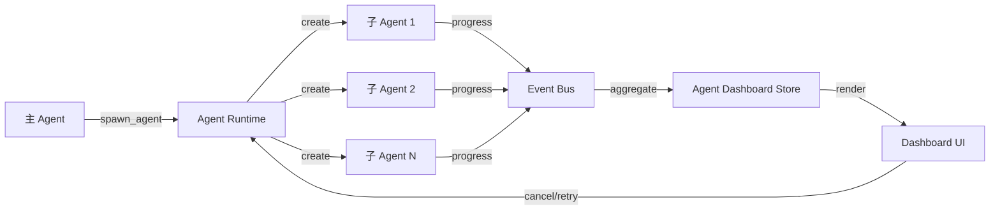

# Phase 2: 子 Agent 并行看板研究设计

## 1. 问题定义

### 1.1 当前痛点

当用户触发多个并行 Agent（如 `spawn_agent` 批次或 `dispatching-parallel-agents` 技能）时：

- **进度不可见**：只能看到主 Agent 的等待态，无法知道各子 Agent 的状态
- **无法定位瓶颈**：不知道哪个子任务在忙、哪个已完成、哪个卡住
- **交互缺失**：子 Agent 失败或需要确认时，用户无感知
- **结果难追溯**：多个子 Agent 返回后，无法对应「谁做了什么」

### 1.2 目标用户场景

| 场景 | 并行数 | 典型任务 |
|------|--------|----------|
| 代码审查 | 3-5 | 安全审查 / 性能审查 / 一致性审查并行 |
| 多文件重构 | 5-10 | 每个文件一个 Agent |
| 研究任务 | 3-8 | 多角度调研（技术选型 / 竞品分析 / 风险评估） |
| 测试覆盖 | 10+ | 每个模块并行写测试 |

### 1.3 设计约束

1. **不破坏现有流程**：单 Agent 场景保持原样
2. **渐进增强**：先视觉呈现，再交互能力，最后深度集成
3. **性能敏感**：10+ 并行时不能卡 UI
4. **与后台任务卡协调**：复用设计语言但不强行统一数据结构

---

## 2. 架构设计

### 2.1 数据流



**关键点**：
- Agent Runtime 已有 `spawn_agent` 实现（`apps/windows/src/main/agent-runtime/agent-spawner.ts`）
- 缺失：子 Agent 进度上报机制 + 前端聚合展示
- 不需要改 Agent 协议，在现有 `tool_start/tool_end/message` 事件上搭建

### 2.2 组件层级

```
ChatPage
├── MessageList
│   ├── ChatMessage (主 Agent)
│   ├── AgentDashboard (NEW) ← 检测到多 spawn_agent 时插入
│   │   ├── DashboardHeader (总览：N 个进行中 / M 个完成)
│   │   ├── AgentCard[] (每个子 Agent 一张卡片)
│   │   │   ├── AgentHeader (名称、状态、耗时)
│   │   │   ├── ProgressIndicator (进度条或步骤列表)
│   │   │   ├── LogPreview (最近 3 条日志)
│   │   │   └── ActionBar (取消/查看详情)
│   │   └── DashboardFooter (批量操作：全部取消 / 导出报告)
│   └── ChatMessage (后续消息)
└── Sidebar (可选：看板视图常驻侧边栏)
```

### 2.3 状态机

每个子 Agent 的状态：

```typescript
type AgentState = 
  | 'queued'      // 已创建但未开始
  | 'running'     // 执行中
  | 'waiting'     // 等待用户确认 / 权限
  | 'completed'   // 成功完成
  | 'failed'      // 失败
  | 'cancelled'   // 用户取消

interface AgentDashboardItem {
  agentId: string
  name: string           // 从 spawn_agent 参数提取
  state: AgentState
  startTime: number
  endTime?: number
  progress?: {
    current: number
    total: number
    message: string
  }
  logs: LogEntry[]       // 最近 N 条
  error?: string
  outputs?: MediaOutput[] // 图片/文件预览
}
```

---

## 3. 实施路线

### Phase 2A: 基础看板（2 周）

**目标**：能看到「谁在跑、谁完成了」

1. **后端改造**（5d）
   - `agent-spawner.ts` 增加进度上报钩子
   - 主进程维护 `AgentDashboardStore`（内存 Map）
   - 通过 IPC 推送给 renderer：`agent:dashboard:update`

2. **前端组件**（5d）
   - 新建 `AgentDashboard/` 组件目录
   - `AgentCard.tsx`：状态图标 + 名称 + 耗时 + 简单进度条
   - `DashboardHeader.tsx`：总览统计
   - 接入 `MessageList.tsx`：检测到 `spawn_agent` 批次时插入看板

3. **验证**（2d）
   - CLI 测试脚本：启动 5 个并行 Agent（3 快 + 1 慢 + 1 失败）
   - 断言：看板渲染、状态更新实时、耗时准确

**交付物**：
- 能看到并行 Agent 列表
- 实时状态更新（转圈 → 完成 / 失败）
- 基本耗时显示

### Phase 2B: 日志与预览（1.5 周）

**目标**：能看到「每个 Agent 在做什么」

1. **日志流**（3d）
   - Agent Runtime 转发子 Agent 的 `tool_start/tool_end` 事件
   - `AgentCard` 展示最近 3 条日志（类似后台任务卡的 `TaskLogs`）
   - 可展开查看完整日志

2. **媒体预览**（3d）
   - 复用 `ResultPreviewPanel` 逻辑
   - 子 Agent 产出图片/视频时，在卡片内显示缩略图
   - 点击缩略图打开 Lightbox

3. **验证**（1d）
   - 测试场景：并行生成 3 张图（每个 Agent 一张）
   - 断言：日志实时、缩略图可点、Lightbox 正常

**交付物**：
- 日志流（最近 N 条 + 可展开）
- 图片/文件预览缩略图

### Phase 2C: 交互控制（1 周）

**目标**：能「取消、重试、查看详情」

1. **取消**（2d）
   - `AgentCard` 添加「取消」按钮
   - 调用 `agent-spawner.ts` 的取消 API
   - 状态更新为 `cancelled`

2. **重试**（2d）
   - 失败的 Agent 显示「重试」按钮
   - 重新 `spawn_agent`（相同参数）

3. **查看详情**（2d）
   - 点击卡片进入「子 Agent 会话详情页」（类似点击会话列表项）
   - 显示完整对话历史、工具调用、输出

4. **验证**（1d）
   - 测试：取消正在运行的 Agent、重试失败的 Agent、查看详情页

**交付物**：
- 取消 / 重试 / 查看详情三个交互
- 状态机正确流转

### Phase 2D: 性能与体验优化（1 周）

**目标**：10+ 并行不卡顿，视觉精致

1. **性能**（3d）
   - 虚拟滚动（10+ Agent 时）
   - 日志流限流（debounce 100ms）
   - 避免全量重渲染（React.memo + 状态分片）

2. **视觉**（2d）
   - 对齐后台任务卡的动效（`--mt-*` 令牌）
   - 状态图标：转圈 / 勾 / 叉 / 警告（SVG，无 emoji）
   - 进度条样式统一

3. **验证**（2d）
   - 压力测试：20 个并行 Agent
   - 录屏验收：流畅度、动效、响应速度

**交付物**：
- 性能指标：10 Agent 时 UI 帧率 >50fps
- 视觉与后台任务卡一致

---

## 4. 技术决策

### 4.1 看板位置

**方案 A**：嵌入 MessageList（推荐）
- 优点：与对话流自然结合、无需额外 UI 空间
- 缺点：多轮对话时看板可能被冲走

**方案 B**：独立侧边栏
- 优点：常驻可见、适合长任务
- 缺点：占用屏幕空间、单 Agent 时浪费

**决策**：先做 A，预留 B 的扩展点（抽离 `AgentDashboardStore` 为独立模块）

### 4.2 数据同步

**方案 A**：IPC 推送（推荐）
- 主进程维护状态，通过 `ipcRenderer.on('agent:dashboard:update')` 推送
- 优点：实时、简单
- 缺点：多窗口需要广播

**方案 B**：轮询
- 前端定时调用 `ipcRenderer.invoke('getAgentDashboard')`
- 优点：多窗口友好
- 缺点：延迟、浪费资源

**决策**：A，多窗口场景后续优化

### 4.3 与后台任务卡的关系

| 维度 | 后台任务卡 | Agent 看板 |
|------|-----------|-----------|
| 数据源 | `BackgroundTaskManager` | `AgentSpawner` |
| 粒度 | 单个后台工具（如 ComfyUI） | 多个子 Agent |
| UI 位置 | MessageList 内嵌 | MessageList 内嵌（批次时） |
| 复用 | 共享 `TaskLogs`、`ResultPreviewPanel` | 共享组件但独立数据流 |

**协调原则**：
- 视觉语言统一（状态图标、动效、颜色）
- 组件复用（日志、预览）
- 数据源隔离（不强行合并两个 Store）

---

## 5. 用户体验流程

### 5.1 正常场景

```
用户：「并行审查这 5 个文件的安全问题」
→ 主 Agent 调用 5 次 spawn_agent
→ MessageList 插入 AgentDashboard
→ 5 个 AgentCard 显示：「安全审查 - file1.ts」等
→ 状态实时更新：2 个完成 ✓、2 个运行中 🔄、1 个失败 ✗
→ 用户点击失败卡片 → 查看错误日志 → 点击「重试」
→ 重试成功 → 看板显示「5/5 完成」
→ 主 Agent 汇总结果并回复
```

### 5.2 异常场景

**场景 A**：某个子 Agent 卡住
- 看板显示「运行中」但长时间无进度
- 超时后自动标记为「疑似卡住」（黄色警告图标）
- 用户可选择「取消」或「继续等待」

**场景 B**：子 Agent 请求用户确认
- 状态变为 `waiting`，图标显示「等待确认」
- 卡片高亮，提示用户操作
- 用户确认后继续

**场景 C**：用户中途离开
- 看板状态持久化到 Session Store
- 重新打开会话时恢复看板（已完成的不再显示，进行中的继续）

---

## 6. 测试策略

### 6.1 单元测试

- `AgentDashboardStore`：状态更新逻辑
- `AgentCard`：不同状态的渲染
- `DashboardHeader`：统计计算

### 6.2 集成测试

- CLI 脚本：模拟 5 个并行 Agent（快/慢/失败混合）
- 断言：
  - 看板渲染正确
  - 状态更新实时
  - 取消/重试功能正常
  - 日志/预览显示正确

### 6.3 E2E 测试

- Playwright：
  - 启动并行任务
  - 点击卡片、取消、重试
  - 截图对比（视觉回归）

### 6.4 性能测试

- 20 个并行 Agent
- 监控：
  - UI 帧率
  - 内存占用
  - IPC 消息频率

---

## 7. 风险与缓解

| 风险 | 影响 | 缓解措施 |
|------|------|----------|
| Agent Runtime 不支持进度上报 | 高 | 先做最小可行版本（只上报状态，不上报进度） |
| 10+ 并行时性能问题 | 中 | 虚拟滚动 + 限流 + React.memo |
| 与后台任务卡视觉不统一 | 低 | 提前对齐设计令牌（`--mt-*`） |
| 子 Agent 会话详情页开发量大 | 中 | Phase 2C 可降级为「查看日志」模态框 |

---

## 8. 后续扩展

### Phase 2+（未来）

1. **依赖可视化**：Agent A 依赖 Agent B 的结果 → 显示依赖图
2. **资源监控**：每个 Agent 的 CPU/内存占用
3. **批量操作**：全选 + 批量取消/重试
4. **看板导出**：导出为 Markdown 报告
5. **侧边栏模式**：长任务时常驻侧边栏

---

## 9. 交付清单

- [x] Phase 2A：基础看板（能看到谁在跑）
- [ ] Phase 2B：日志与预览（**不做**，理由见 §11.2）
- [x] Phase 2C：交互控制（取消 / 详情；重试见 §11.3）
- [x] Phase 2D：性能与体验优化（令牌对齐 / 单一计时器 / 无虚拟滚动，见 §11.4）
- [x] 单元测试（`AgentDashboard.test.tsx` 6 例）
- [x] E2E 测试脚本（`docs/test/lumii-cli/chat/run-agent-dashboard.mjs` + `probe-async-parallel.mjs`）
- [x] 设计文档更新（本节 §11 实施记录）
- [ ] 用户指南（如何使用 Agent 看板）

---

## 11. 实施记录（2026-10-24）

### 11.1 落在哪里

| 层 | 文件 | 做了什么 |
|----|------|----------|
| 数据 | `bridge-lifecycle.ts` `pushActivitySnapshot` | 名字优先取 broker 的 `run.name`（委托时模型给的任务级名），否则并行时一排卡片全叫「系统默认」 |
| 数据 | `bridge-agent-instance-events.ts` | `agent:state-change` 时补推一次快照——此前只在实例创建/销毁时推，中间真正的 running 态无人知晓 |
| 数据 | `bridge-instance-factory.ts` | 把 `pushActivitySnapshot` 注入事件处理器 |
| 渲染 | `ChatPage/components/AgentDashboard/` | 看板组件 + CSS + 单测（6 例） |
| 接线 | `ChatContainer` / `ChatPage.tsx` | 传 `activeAgents` 与 `onCancelAgent`；空会话也挂 |
| 命令 | `command-allowlist.ts` | 放行 `agentInstance:abort`（与 `background-task:cancel` 同级） |

**数据源就是既有的 `agent:activity:snapshot`**，没有新建 Store——快照里本来就有
instanceId / name / state / mode / broker status / startedAt / lastProgressAt，
只是此前没人消费。

### 11.2 Phase 2B 不做（日志与媒体预览）

每个子运行的完整轨迹（思考 / 工具 / 文件变更 / 失败原因）**已经在 `SpawnAgentCard`
内部按 instanceId 渲染**（见 `08-委托可见性.md` §4）。看板再抄一份日志流与缩略图，
只是把同一份数据画两遍，还多两条需要同步的生命周期。跳转交给「详情」按钮。

### 11.3 Phase 2C 的「重试」不做（架构原因）

看板的数据源是**活实例快照**：子 Agent 投递完成/失败后实例立即 destroy，快照里就没了。
「重试一个失败的 Agent」必须针对一条**还看得见的失败记录**，而那个记录只存在于
委托卡片（`SpawnAgentCard` 的 `status: 'error'`）里。把重试放到看板上等于给一个
已经不存在的对象加按钮。要做的话正确落点是委托卡片，需要额外把 spawn 入参持久化
到 broker 之外——另一件事，不塞进看板。

「查看详情」按文档 §7 的降级方案实现：子 Agent 没有独立会话（与父共用
conversationId），所以详情 = 滚动到下方对应的运行轨迹块（`data-instance-id`）。

### 11.4 性能取舍

- **不虚拟滚动**：并发上限 `SUBAGENT_DEFAULTS.hardMaxConcurrent = 10`，10 张纯文本卡片不需要窗口化。
- **单一计时器**：整块看板共用一个 1s interval（只在可见时启动），10 张卡各自 setInterval 是纯浪费。
- **收敛时粘住**：3 个跑完 2 个会瞬间只剩 1 个，若严格按「≥2 才显示」面板会在用户眼前
  闪没（实测）。现在一旦并行过就保持到子 Agent 全部退场，最后那个仍可取消。

### 11.5 实测结论（真实客户端）

`probe-async-parallel.mjs` 用真实模型派两个 `mode:"async"` 子 Agent，观测到：

```
t=5s  统计(idle/running) + 系统默认(idle)   dash=true
t=6s  统计(running) + 列举(running)         dash=true   ← 真正的并行
t=9s  统计(idle/succeeded) + 列举(running)  dash=true
t=11s 统计(idle/succeeded)                  dash=true   ← 粘住，未闪没
```

最大并发 2；`run-agent-dashboard.mjs` 另外覆盖了单 Agent 不显示、3 卡渲染、
状态文案、取消按钮、清空后消失五条断言。

**限制**：看板只反映**当前打开的会话**。子 Agent 都在后台会话里跑时看不到——
这与后台任务卡同一口径（`switchSession` 进入该会话即可看到）。跨会话的全局看板
属于 §8 的「侧边栏模式」，未做。


---

## 10. 参考

- 现有实现：
  - `apps/windows/src/main/agent-runtime/agent-spawner.ts`
  - `apps/windows/src/renderer/pages/ChatPage/components/BackgroundTaskCard/`
- 相关研究：
  - `docs/research/copilotkit-research-findings.md`（任务进度设计）
- 类似产品：
  - GitHub Actions 并行任务看板
  - CI/CD Pipeline 可视化

---

## 附录：数据结构定义

```typescript
// apps/windows/src/shared/types/agent-dashboard.ts

export type AgentState = 
  | 'queued' 
  | 'running' 
  | 'waiting' 
  | 'completed' 
  | 'failed' 
  | 'cancelled'

export interface LogEntry {
  level: 'info' | 'warn' | 'error'
  message: string
  timestamp: number
}

export interface MediaOutput {
  type: 'image' | 'video' | 'file'
  url: string
  thumbnail?: string
  name?: string
}

export interface AgentProgress {
  current: number
  total: number
  message: string
  estimatedRemaining?: number // 秒
}

export interface AgentDashboardItem {
  agentId: string
  name: string
  description?: string
  state: AgentState
  startTime: number
  endTime?: number
  elapsed: number // 已用时间（秒）
  progress?: AgentProgress
  logs: LogEntry[]
  error?: string
  outputs: MediaOutput[]
  canCancel: boolean
  canRetry: boolean
}

export interface AgentDashboardSummary {
  total: number
  queued: number
  running: number
  waiting: number
  completed: number
  failed: number
  cancelled: number
}

// IPC 事件
export interface AgentDashboardUpdateEvent {
  sessionId: string
  items: AgentDashboardItem[]
  summary: AgentDashboardSummary
}
```
