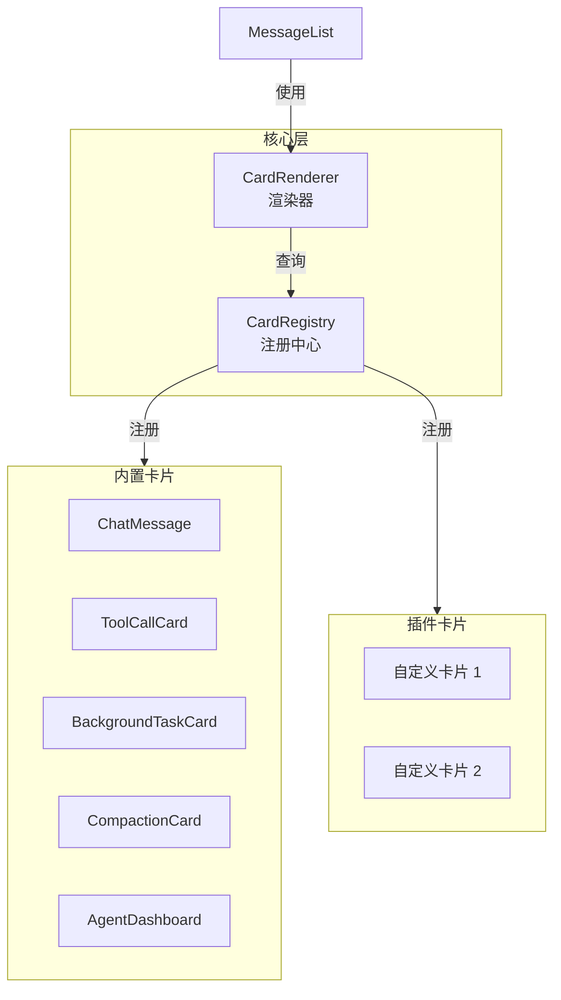

# Phase 3: CardRegistry 插件化架构研究设计

## 1. 问题定义

### 1.1 当前痛点

聊天页面的卡片类型已经多达 5 种，且仍在增长：

```
MessageList
├── ChatMessage (用户/助手消息)
├── ToolCallCard (同步工具调用)
├── BackgroundTaskCard (后台任务)
├── CompactionCard (上下文压缩)
└── AgentDashboard (Phase 2，子 Agent 看板)
```

**核心问题**：
1. **耦合严重**：`MessageList.tsx` 包含所有卡片的渲染逻辑，1000+ 行
2. **扩展困难**：新增卡片类型需要修改核心组件，影响稳定性
3. **样式不统一**：每种卡片独立开发，视觉语言分裂
4. **无法插件化**：用户/开发者无法贡献自定义卡片

### 1.2 目标

**短期**（Phase 3A）：
- 将现有卡片抽离为独立模块
- 建立统一的卡片注册与渲染机制
- 减少核心组件复杂度

**长期**（Phase 3B+）：
- 支持第三方卡片插件
- 提供卡片开发脚手架
- 建立卡片市场

### 1.3 设计原则

1. **渐进式重构**：不破坏现有功能，逐步迁移
2. **向后兼容**：旧卡片继续工作，新卡片走新机制
3. **性能优先**：注册机制不能拖慢渲染
4. **开发者友好**：清晰的 API、完善的类型定义、详细的文档

---

## 2. 架构设计

### 2.1 总体架构



### 2.2 核心组件

#### A. CardRegistry（注册中心）

```typescript
// apps/windows/src/renderer/components/CardRegistry/CardRegistry.ts

export interface CardDefinition<T = any> {
  id: string                    // 唯一标识（如 'tool-call', 'background-task'）
  name: string                  // 显示名称
  description?: string          // 描述
  version: string               // 版本号（semver）
  
  // 匹配器：判断某个消息是否使用此卡片
  matcher: (message: ChatMessageType) => boolean
  
  // 组件：实际渲染的 React 组件
  component: React.ComponentType<CardProps<T>>
  
  // 可选：数据转换器（将消息转为组件 props）
  transformer?: (message: ChatMessageType) => T
  
  // 可选：样式覆盖
  styles?: React.CSSProperties
  
  // 可选：优先级（数字越大越优先，默认 0）
  priority?: number
}

export class CardRegistry {
  private cards = new Map<string, CardDefinition>()
  
  // 注册卡片
  register(card: CardDefinition): void {
    if (this.cards.has(card.id)) {
      logger.warn(`[CardRegistry] 卡片 ${card.id} 已存在，将覆盖`)
    }
    this.cards.set(card.id, card)
  }
  
  // 批量注册
  registerMany(cards: CardDefinition[]): void {
    cards.forEach(c => this.register(c))
  }
  
  // 查找匹配的卡片（按优先级排序）
  findCard(message: ChatMessageType): CardDefinition | null {
    const matches = Array.from(this.cards.values())
      .filter(card => card.matcher(message))
      .sort((a, b) => (b.priority ?? 0) - (a.priority ?? 0))
    
    return matches[0] ?? null
  }
  
  // 获取所有已注册卡片
  getAll(): CardDefinition[] {
    return Array.from(this.cards.values())
  }
  
  // 注销卡片
  unregister(id: string): boolean {
    return this.cards.delete(id)
  }
}

// 单例
export const cardRegistry = new CardRegistry()
```

#### B. CardRenderer（渲染器）

```typescript
// apps/windows/src/renderer/components/CardRegistry/CardRenderer.tsx

export interface CardProps<T = any> {
  message: ChatMessageType
  data: T                       // 由 transformer 生成
  sessionId: string
  onAction?: (action: CardAction) => void
}

export interface CardAction {
  type: string                  // 如 'cancel', 'retry', 'expand'
  payload?: any
}

export const CardRenderer: React.FC<{
  message: ChatMessageType
  sessionId: string
  onAction?: (action: CardAction) => void
}> = ({ message, sessionId, onAction }) => {
  const card = cardRegistry.findCard(message)
  
  if (!card) {
    // 降级：显示默认消息卡片
    return <DefaultMessageCard message={message} />
  }
  
  const Component = card.component
  const data = card.transformer ? card.transformer(message) : message
  
  return (
    <div className="card-container" style={card.styles}>
      <Component 
        message={message}
        data={data}
        sessionId={sessionId}
        onAction={onAction}
      />
    </div>
  )
}
```

#### C. MessageList 重构

```typescript
// apps/windows/src/renderer/pages/ChatPage/MessageList.tsx

export const MessageList: React.FC<Props> = ({ sessionId }) => {
  const messages = useMessages(sessionId)
  
  return (
    <div className="message-list">
      {messages.map(msg => (
        <CardRenderer
          key={msg.id}
          message={msg}
          sessionId={sessionId}
          onAction={handleCardAction}
        />
      ))}
    </div>
  )
}

// 处理卡片动作
function handleCardAction(action: CardAction) {
  switch (action.type) {
    case 'cancel':
      // 取消后台任务
      break
    case 'retry':
      // 重试失败的操作
      break
    case 'expand':
      // 展开卡片详情
      break
  }
}
```

### 2.3 内置卡片迁移示例

#### ToolCallCard 迁移

```typescript
// apps/windows/src/renderer/components/Cards/ToolCallCard/register.ts

import { CardDefinition } from '../../CardRegistry/CardRegistry'
import { ToolCallCardComponent } from './ToolCallCardComponent'

export const toolCallCardDefinition: CardDefinition = {
  id: 'tool-call',
  name: '工具调用卡片',
  version: '1.0.0',
  priority: 10,
  
  matcher: (message) => {
    return message.type === 'assistant' && 
           message.tool_calls && 
           message.tool_calls.length > 0
  },
  
  component: ToolCallCardComponent,
  
  transformer: (message) => ({
    toolCalls: message.tool_calls,
    status: message.status,
    elapsed: message.elapsed,
  }),
}

// 注册（在应用启动时）
cardRegistry.register(toolCallCardDefinition)
```

#### BackgroundTaskCard 迁移

```typescript
// apps/windows/src/renderer/components/Cards/BackgroundTaskCard/register.ts

export const backgroundTaskCardDefinition: CardDefinition = {
  id: 'background-task',
  name: '后台任务卡片',
  version: '1.0.0',
  priority: 20, // 高于普通工具卡片
  
  matcher: (message) => {
    return message.metadata?.background_task === true
  },
  
  component: BackgroundTaskCardComponent,
  
  transformer: (message) => ({
    taskId: message.metadata.task_id,
    progress: message.metadata.progress,
    milestones: message.metadata.milestones,
    logs: message.metadata.logs,
    outputs: message.metadata.outputs,
  }),
}

cardRegistry.register(backgroundTaskCardDefinition)
```

---

## 3. 插件化扩展（Phase 3B）

### 3.1 插件结构

```
my-custom-card-plugin/
├── package.json
├── src/
│   ├── index.ts              # 入口，导出 CardDefinition
│   ├── MyCard.tsx            # 卡片组件
│   ├── MyCard.module.css     # 样式
│   └── types.ts              # 类型定义
└── README.md
```

### 3.2 插件开发示例

```typescript
// my-custom-card-plugin/src/index.ts

import { CardDefinition } from '@lumii/card-registry'
import { MyCard } from './MyCard'

export const myCardPlugin: CardDefinition = {
  id: 'my-custom-card',
  name: '我的自定义卡片',
  version: '1.0.0',
  
  matcher: (message) => {
    // 匹配逻辑：如消息包含特定 metadata
    return message.metadata?.custom_card_type === 'my-card'
  },
  
  component: MyCard,
  
  transformer: (message) => ({
    title: message.metadata.title,
    content: message.metadata.content,
  }),
}
```

### 3.3 插件加载机制

```typescript
// apps/windows/src/renderer/plugins/plugin-loader.ts

export class PluginLoader {
  private plugins = new Map<string, CardDefinition>()
  
  // 从本地目录加载插件
  async loadFromDirectory(dir: string): Promise<void> {
    const pluginFiles = await fs.readdir(dir)
    
    for (const file of pluginFiles) {
      if (file.endsWith('.plugin.js')) {
        const plugin = await import(path.join(dir, file))
        this.registerPlugin(plugin.default)
      }
    }
  }
  
  // 从 npm 包加载插件
  async loadFromPackage(packageName: string): Promise<void> {
    const plugin = await import(packageName)
    this.registerPlugin(plugin.default)
  }
  
  private registerPlugin(plugin: CardDefinition): void {
    // 验证插件
    if (!this.validatePlugin(plugin)) {
      logger.error(`[PluginLoader] 插件 ${plugin.id} 验证失败`)
      return
    }
    
    // 注册到 CardRegistry
    cardRegistry.register(plugin)
    this.plugins.set(plugin.id, plugin)
    
    logger.info(`[PluginLoader] 已加载插件: ${plugin.name} v${plugin.version}`)
  }
  
  private validatePlugin(plugin: any): plugin is CardDefinition {
    return (
      typeof plugin.id === 'string' &&
      typeof plugin.name === 'string' &&
      typeof plugin.version === 'string' &&
      typeof plugin.matcher === 'function' &&
      typeof plugin.component === 'function'
    )
  }
}

export const pluginLoader = new PluginLoader()
```

### 3.4 插件配置

用户可通过配置文件启用/禁用插件：

```json
// ~/.lumii/plugins.json
{
  "plugins": [
    {
      "id": "my-custom-card",
      "enabled": true,
      "source": "npm:@lumii-plugins/my-custom-card"
    },
    {
      "id": "another-card",
      "enabled": false,
      "source": "local:./plugins/another-card.plugin.js"
    }
  ]
}
```

---

## 4. 实施路线

### Phase 3A: 核心重构（3 周）

**目标**：建立 CardRegistry 机制，迁移现有卡片

#### Week 1: 基础架构（5d）

1. **CardRegistry 实现**（2d）
   - 编写 `CardRegistry.ts`
   - 单元测试（注册、查找、优先级）

2. **CardRenderer 实现**（2d）
   - 编写 `CardRenderer.tsx`
   - 集成到 `MessageList.tsx`

3. **验证**（1d）
   - 创建 demo 卡片测试注册与渲染
   - 确保降级逻辑正常（未匹配卡片时）

#### Week 2: 内置卡片迁移（5d）

1. **迁移 ToolCallCard**（1d）
   - 提取 `ToolCallCardComponent`
   - 编写 `register.ts`
   - 更新单元测试

2. **迁移 BackgroundTaskCard**（1.5d）
   - 提取组件
   - 注册定义
   - 验证进度、日志、预览功能

3. **迁移 CompactionCard**（1d）
   - 提取组件
   - 注册定义

4. **迁移 AgentDashboard**（1d，依赖 Phase 2）
   - 提取组件
   - 注册定义

5. **回归测试**（0.5d）
   - 复跑所有 E2E 测试
   - 手工验证每种卡片

#### Week 3: 统一样式与优化（5d）

1. **设计令牌统一**（2d）
   - 定义 `--card-*` CSS 变量（边框、圆角、阴影、间距）
   - 所有卡片迁移到新令牌

2. **性能优化**（2d）
   - React.memo 优化卡片组件
   - 避免不必要的重渲染
   - 测试 100+ 消息场景

3. **文档**（1d）
   - 编写 CardRegistry 使用指南
   - 更新组件文档

**交付物**：
- 所有内置卡片已迁移到 CardRegistry
- MessageList 复杂度降低 60%+
- 样式统一，视觉一致

### Phase 3B: 插件化支持（2 周）

**目标**：支持第三方插件加载

#### Week 1: 插件加载器（5d）

1. **PluginLoader 实现**（2d）
   - 从本地目录加载
   - 从 npm 包加载
   - 插件验证逻辑

2. **插件配置**（1d）
   - 读取 `~/.lumii/plugins.json`
   - 启用/禁用插件
   - 配置 UI（设置页面）

3. **沙箱隔离**（2d）
   - 插件运行在隔离环境（避免污染主进程）
   - 限制插件可调用的 API

#### Week 2: 开发者工具（5d）

1. **脚手架**（2d）
   - `lumii create-card-plugin` 命令
   - 生成插件模板

2. **调试工具**（2d）
   - 插件开发模式（热重载）
   - 插件调试面板（查看已加载插件、日志）

3. **文档与示例**（1d）
   - 插件开发指南
   - 示例插件（如「天气卡片」）

**交付物**：
- 插件加载机制完整
- 脚手架与开发工具
- 文档与示例

### Phase 3C: 插件市场（4 周，可选）

**目标**：建立插件生态

1. **插件市场后端**（2 周）
   - 插件上传 API
   - 插件搜索与评分
   - 版本管理

2. **插件市场 UI**（1.5 周）
   - 浏览插件
   - 一键安装/卸载
   - 评论与评分

3. **审核机制**（0.5 周）
   - 插件提交审核流程
   - 安全扫描（避免恶意插件）

---

## 5. 技术决策

### 5.1 注册时机

**方案 A**：应用启动时注册（推荐）
- 在 `app.tsx` 或 `main.ts` 启动时批量注册所有内置卡片
- 优点：简单、快速
- 缺点：插件懒加载需要额外机制

**方案 B**：懒注册
- 第一次匹配时才加载卡片组件
- 优点：按需加载，减少初始化时间
- 缺点：实现复杂，首次渲染可能有延迟

**决策**：A（启动时注册），插件支持懒加载

### 5.2 匹配优先级

当多个卡片都匹配同一消息时，按以下规则：

1. **优先级数字**：`priority` 大的优先
2. **注册顺序**：同优先级时，后注册的优先（允许覆盖）
3. **内置 > 插件**：内置卡片默认 priority >= 10，插件默认 0

### 5.3 插件安全

**沙箱隔离**：
- 插件运行在受限环境（Web Worker 或 iframe）
- 只能访问白名单 API（如 `cardRegistry`, `logger`）
- 不能直接访问文件系统、网络、主进程

**审核机制**：
- 插件提交时自动扫描（静态分析 + 沙箱测试）
- 人工审核高风险插件
- 用户可选择「仅安装已审核插件」

---

## 6. 用户体验

### 6.1 开发者：创建插件

```bash
# 1. 创建插件项目
$ lumii create-card-plugin my-weather-card
✓ 已创建插件模板: ./my-weather-card/

# 2. 开发
$ cd my-weather-card
$ npm run dev  # 热重载模式

# 3. 测试
$ npm test

# 4. 发布
$ npm publish
```

### 6.2 用户：安装插件

**方式 1：通过 UI**
```
设置 → 插件 → 浏览市场 → 搜索「天气」 → 点击「安装」
```

**方式 2：通过命令行**
```bash
$ lumii plugin install @lumii-plugins/weather-card
✓ 已安装插件: weather-card v1.0.0
```

**方式 3：从本地文件**
```bash
$ lumii plugin install ./my-custom-card.plugin.js
```

### 6.3 用户：管理插件

```
设置 → 插件
├── 已安装（3）
│   ├── weather-card v1.0.0 [启用] [卸载]
│   ├── github-card v2.1.0 [禁用] [卸载]
│   └── custom-card v0.1.0 [启用] [卸载]
└── 浏览市场
    └── [搜索框] [分类筛选] [排序]
```

---

## 7. 测试策略

### 7.1 单元测试

- `CardRegistry`: 注册、查找、优先级
- `CardRenderer`: 匹配、渲染、降级
- 每个内置卡片: 不同状态的渲染

### 7.2 集成测试

- 多卡片混合场景（工具 + 后台任务 + 压缩）
- 插件加载与卸载
- 插件优先级覆盖

### 7.3 E2E 测试

- 用户安装插件 → 触发匹配 → 卡片正常渲染
- 插件禁用后不再渲染
- 插件更新后自动重载

### 7.4 性能测试

- 100+ 消息渲染（每种卡片 20 条）
- 插件加载时间 <1s
- 卡片渲染帧率 >50fps

---

## 8. 风险与缓解

| 风险 | 影响 | 缓解措施 |
|------|------|----------|
| 内置卡片迁移引入 bug | 高 | 完善单元测试 + E2E 回归 |
| 插件恶意代码 | 高 | 沙箱隔离 + 审核机制 |
| 插件性能差拖慢 UI | 中 | 超时机制 + 性能监控 |
| 插件 API 设计不合理 | 中 | Phase 3A 充分验证内置卡片 |
| 插件市场开发量大 | 低 | Phase 3C 可延后或外包 |

---

## 9. 后续扩展

### Phase 3+（未来）

1. **卡片主题**：用户可自定义卡片配色
2. **卡片模板**：提供多种布局模板（单列、双列、网格）
3. **卡片交互增强**：拖拽排序、分组折叠
4. **卡片导出**：导出为图片、PDF
5. **跨平台插件**：Web、Mobile 端共享插件

---

## 10. 交付清单

- [ ] Phase 3A: 核心重构
  - [ ] CardRegistry 实现
  - [ ] CardRenderer 实现
  - [ ] 5 个内置卡片迁移
  - [ ] 样式统一（`--card-*` 令牌）
  - [ ] 性能优化（React.memo）
  - [ ] 单元测试覆盖 80%+
  - [ ] E2E 回归测试通过

- [ ] Phase 3B: 插件化支持
  - [ ] PluginLoader 实现
  - [ ] 插件配置（`plugins.json`）
  - [ ] 沙箱隔离
  - [ ] 脚手架（`create-card-plugin`）
  - [ ] 调试工具
  - [ ] 插件开发文档
  - [ ] 示例插件（天气卡片）

- [ ] Phase 3C: 插件市场（可选）
  - [ ] 后端 API
  - [ ] 市场 UI
  - [ ] 审核机制

---

## 11. 参考

- 现有实现：
  - `apps/windows/src/renderer/pages/ChatPage/MessageList.tsx`
  - `apps/windows/src/renderer/pages/ChatPage/components/`
- 类似产品：
  - VS Code 扩展机制
  - Obsidian 插件系统
  - Figma 插件
- 技术参考：
  - [React 插件化架构](https://reactjs.org/docs/plugins.html)
  - [Web Worker 沙箱](https://developer.mozilla.org/en-US/docs/Web/API/Web_Workers_API)

---

## 附录：完整 API 定义

```typescript
// apps/windows/src/renderer/components/CardRegistry/types.ts

export interface CardDefinition<T = any> {
  id: string
  name: string
  description?: string
  version: string
  priority?: number
  
  matcher: (message: ChatMessageType) => boolean
  component: React.ComponentType<CardProps<T>>
  transformer?: (message: ChatMessageType) => T
  
  styles?: React.CSSProperties
  className?: string
  
  // 插件元数据
  author?: string
  homepage?: string
  repository?: string
  license?: string
  keywords?: string[]
}

export interface CardProps<T = any> {
  message: ChatMessageType
  data: T
  sessionId: string
  onAction?: (action: CardAction) => void
}

export interface CardAction {
  type: string
  payload?: any
}

export interface PluginConfig {
  id: string
  enabled: boolean
  source: string  // 'npm:package-name' | 'local:path/to/file.js'
  config?: Record<string, any>
}

export interface PluginManifest {
  name: string
  version: string
  description: string
  author: string
  main: string  // 入口文件
  lumii: {
    minVersion: string  // 最低兼容的 Lumii 版本
    maxVersion?: string
  }
}
```
